# FoodLog design consistency audit — October 12, 2026

The main experience now uses shared roles for fields, dialog titles, form actions, close controls, and spacing. The supplied wordmarks, white/teal/taupe palette, square restaurant rows, metadata pills, and all product behavior remain intact.

This review used current in-app-browser screenshots and computed styles from the local app, plus fixture-based browser checks. It applied Impeccable polish and Product Design audit guidance. No production records were read or written.

## Findings and corrections

| Role | Observed before | Result |
| --- | --- | --- |
| Field values | Dish/review/filter values inherited 12px / 760; restaurant fields were 16px / 400 | 16px / 400, 48px minimum field height |
| Dialog titles | Filters 20px / 800; settings/reviews 24px; restaurant 26px; dish 32px | 24px / 700 Helvetica, common line-height and tracking |
| Save controls | Restaurant: 52px high, 17px text, 16px corners; dish: 48px high, 16px text, 12px corners; review: 44px high | All form actions: 48px minimum, 16px / 700 text, 12px corners |
| Close SVGs | Filter X used a 16px inherited box; capture/review X used 24px | 24px SVG boxes, common stroke, unchanged borderless 44px targets |
| Capture display text | Some capture/empty headings hardcoded Bricolage instead of the display token | Shared display font token |
| Peer/helper gaps | Dish footer applied the same gap to peer actions and helper notes | 12px between peers, 8px to related notes |
| Horizontal control scroll | Visit controls showed a scrollbar while playlist controls hid it | Matching unobtrusive scrollbar treatment; native scrolling preserved |
| Empty rating marks | 1.94:1 on white, 2.49:1 on dark panel | 3.42:1 light; 4.24:1 on the dark soft surface |

Phone filters use one column at 430px and below so enlarged values remain readable. The 390px in-app capture measured the action footer at 828px within the 844px viewport. Numeric price text retains its Helvetica exception. The Restaurant name label and persistent accent outline retain their stronger emphasis.

Consistency follows function: restaurant rows are square, navigation/tags are pills, fields use 12px corners, dialogs retain their surface shape, and close/bookmark controls remain borderless. These intentional differences were preserved.

## Reviewed steps and evidence

### 1. Restaurant list — coherent

White/teal/taupe roles, row corners, spacing, rating placement, and theme-specific logo behavior remain consistent. Native horizontal chip scrolling is preserved with less visual noise.

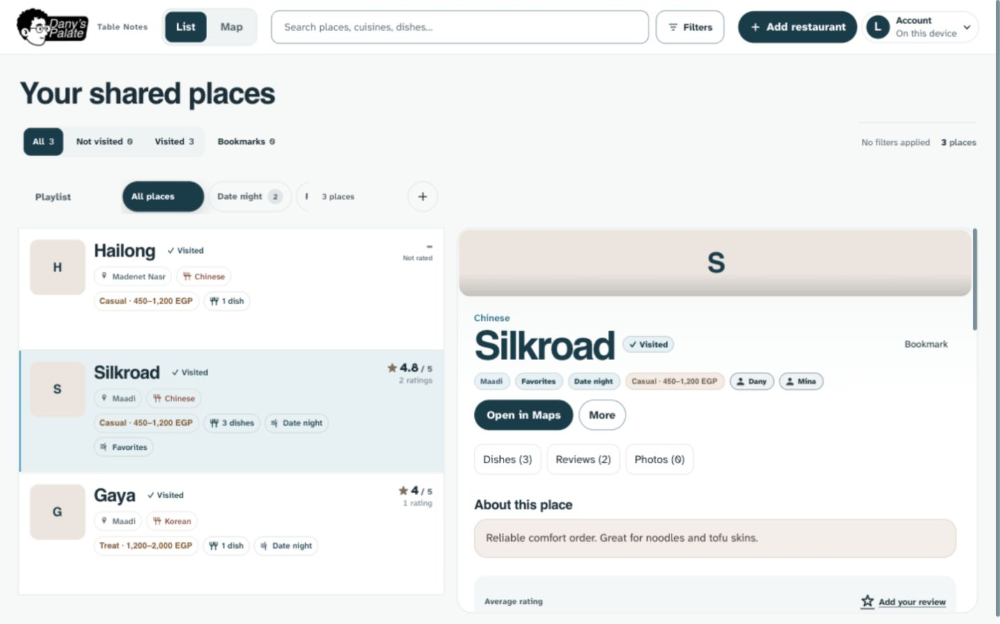
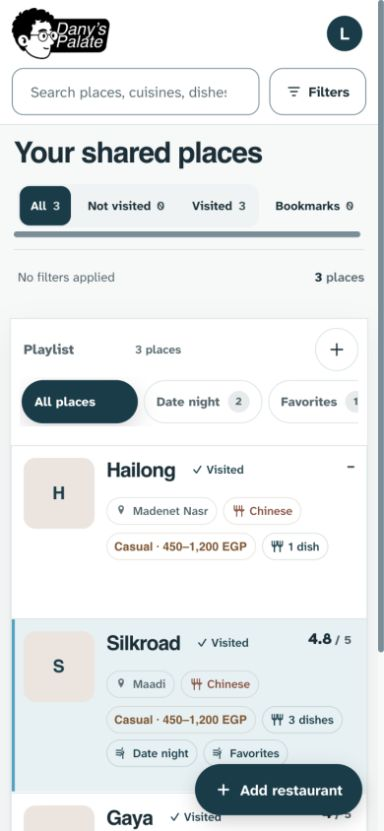

### 2. Filters — corrected

Inherited small/bold values and smaller title/X treatment were inconsistent with capture. Fields now use shared readable typography; phone layout reserves enough width and keeps footer actions visible.

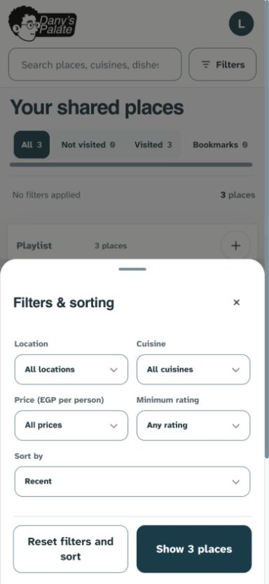
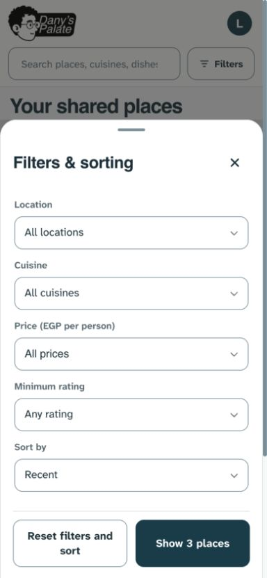

### 3. Restaurant capture — corrected

Mandatory-name emphasis and the existing flow remain. The title and Save control now match the shared form roles rather than using one-off sizes.

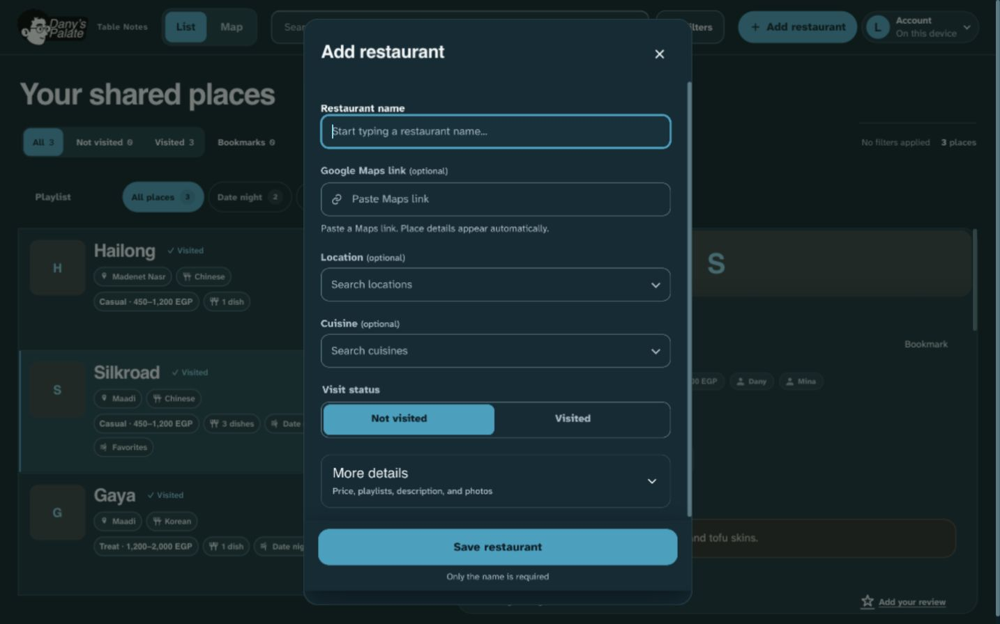
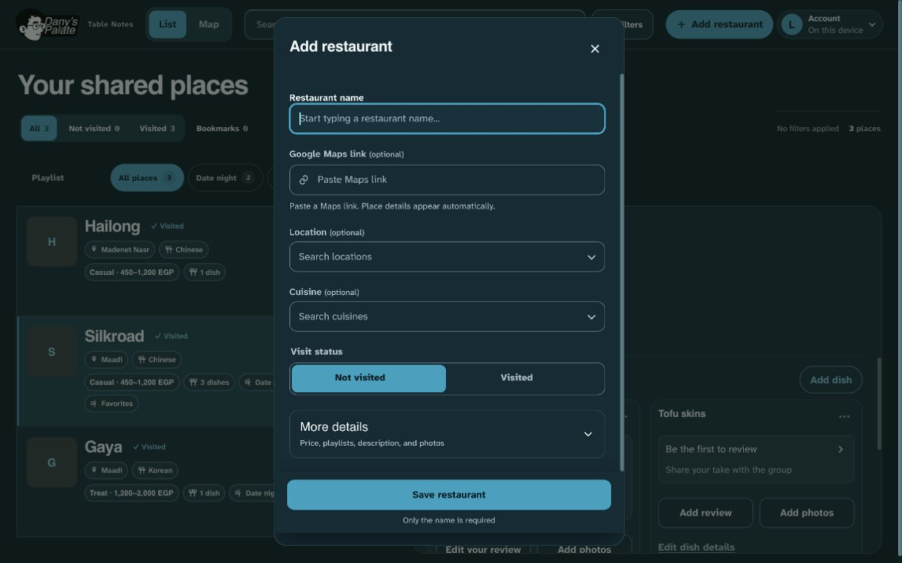

### 4. Account menu — coherent

Icon/text grouping and theme/recovery actions were already consistent. Menu labels and keyboard/focus behavior remain intact.

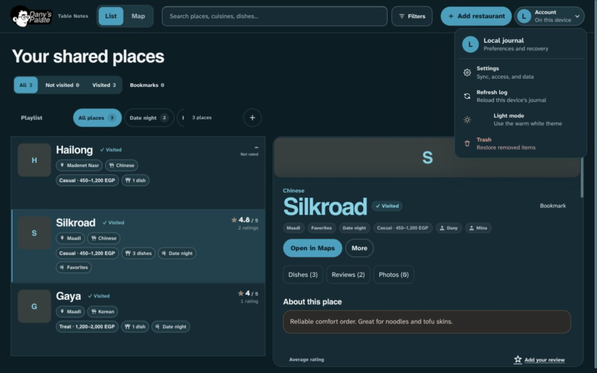

### 5. Settings — coherent within available local view

The existing 24px title provided the dialog-title reference. Local sync status remains clearly separated from actions. Owner-only connected sections were covered with mocked regressions, not manually captured against production.

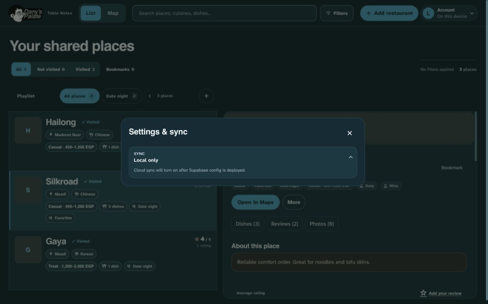

### 6. Dish capture — corrected

Dish name no longer inherits the label’s 12px bold styling, and the oversized 32px title now matches restaurant/review dialogs. Save and alternate Save share typography, targets, and corners.

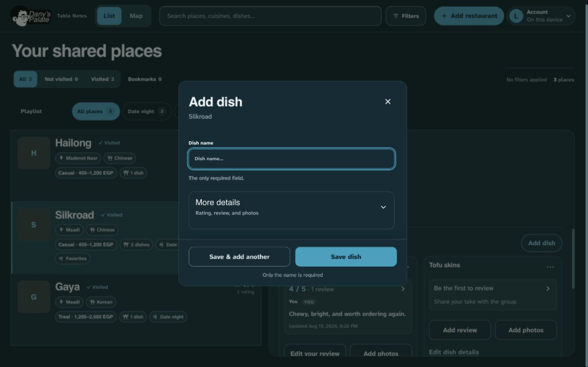

### 7. Detail and contribution controls — coherent

Navigation, photos, dish reviews, and contribution actions retain their grouping and purpose. Compact rating stepper controls now share the control corner/weight rules. Existing data/actions were preserved.

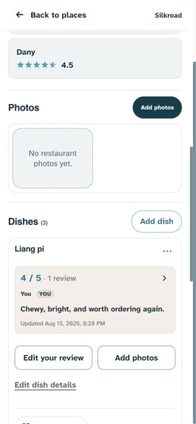

### 8. Review entry — corrected

The review textarea now uses regular 16px text. Save uses the shared action role; unselected rating marks have sufficient non-text contrast. Rating labels, numeric readout, optional review, and keyboard behavior remain intact.

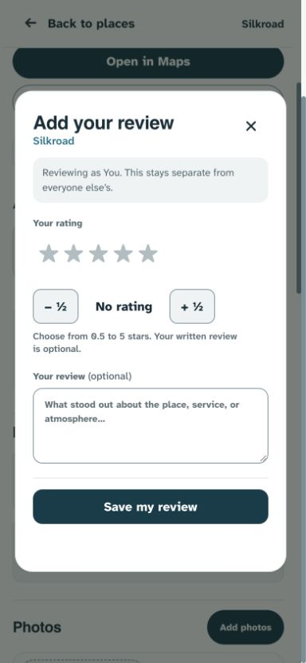
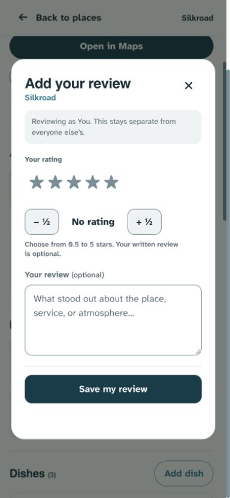

## Verification and limits

- All 127 unit/source checks passed and the build completed.
- Complete fixture/mock browser suite: 326 passed, 16 device-specific skips.
- Targeted narrow-form/lookup/contrast checks: 13 passed, one viewport skip; final both-theme contrast checks: four passed.
- Current in-app-browser measurements confirmed shared title/field/action/icon roles; captured desktop and phone comparisons were inspected before acceptance.
- Full regressions cover add/edit, drafts, rating increments, photos, failed-save recovery, lookup/playlist scrolling, bookmarks, Trash, navigation, theme persistence, account keyboard/focus, and narrow both-theme accessibility.
- The mechanical scan’s flat-type-hierarchy warning is resolved. Helvetica warnings are intentionally retained because Dany selected Helvetica. Existing legacy literal-value/sidecar advisories were not treated as reasons to replace the approved design.
- This is not a claim of full WCAG conformance. Physical devices, screen-reader narration, live production cloud/auth behavior, and connected owner-only visual states were not manually audited. Their local mocks were used where available.
- No push or deployment was performed.
