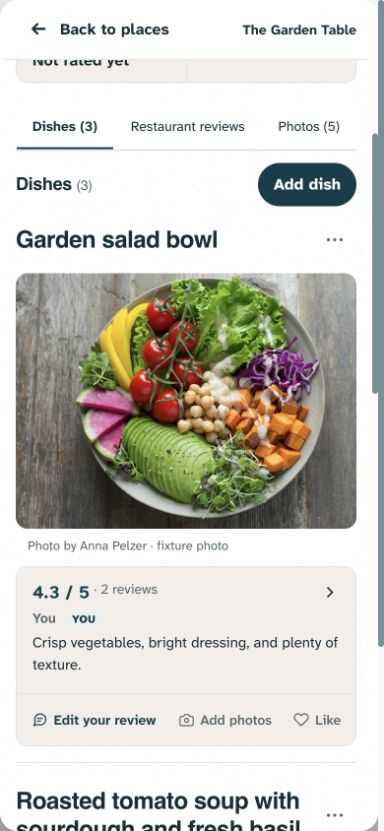
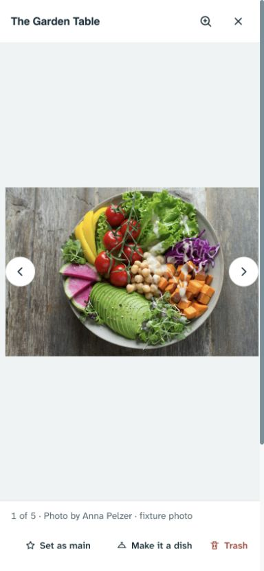
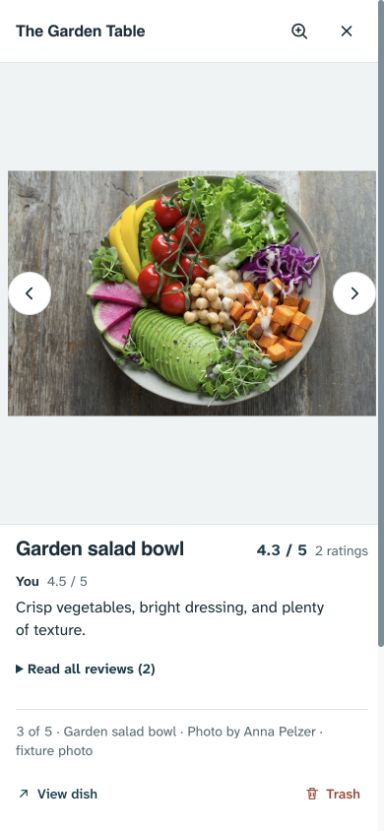
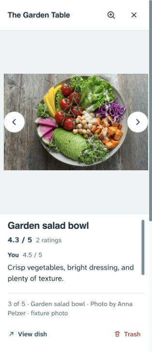
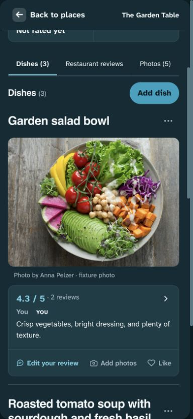
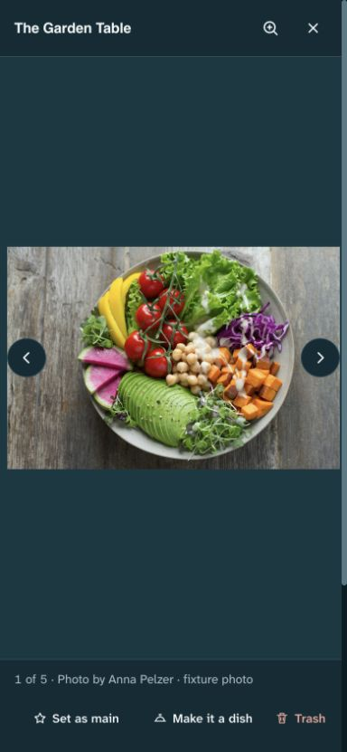
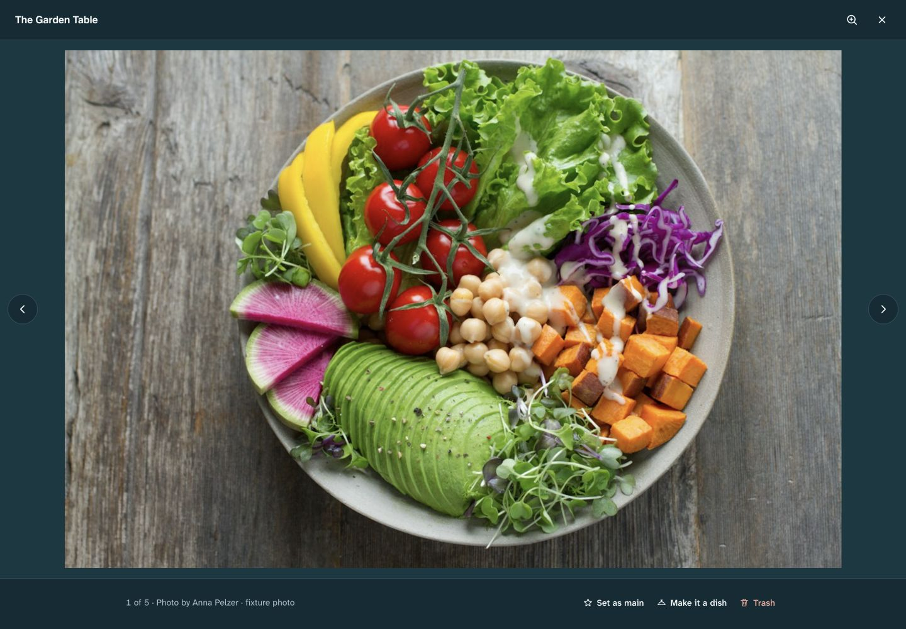

# Compact dish and photo actions — 1 November 2026

**Implemented locally; not pushed or deployed.** Dany rejected the tall, stacked-icon dish and viewer buttons and asked whether View dish remained useful after reviews were added to the viewer. Published baseline: `5c14c7e`, with later documentation stamps possible.

## Decision: keep access to the dish, reduce its prominence

The viewer now covers reading existing opinions. The dish still provides writing/editing your review, adding photos, Like/liker identities and permission-aware dish management. View dish therefore has a distinct job: moving from photo viewing to the complete dish context. Removing that route would force people to close the viewer and library and locate the correct dish themselves.

View dish is now a quiet text-style navigation action next to/below the caption. It no longer sits among the management tiles. This route remains available for rated and unrated dish photos and for readers, with its existing handoff, library close and destination focus. It is still a native button because it performs the existing dialog-to-dish handoff rather than navigating to a separate URL. Place-photo conversion remains a command in the photo-management row.

This is a product-specific hierarchy decision, not a universal rule that a gallery must always include a View dish button. It preserves a useful route while reducing the attention it receives.

## Compact controls

- Dish contribution controls become one compact inline row attached to the opinion surface. The background matches the opinion, with no vertical cell dividers or separate resting fills. Icons decrease from 20px to 16px; labels remain 14px. Review has modestly stronger emphasis. Longer labels receive more width, and wrap at narrow widths.
- At the inspected 390px phone viewport, the dish strip is **53px high**, with **44px button targets**. The previous stacked layout reserved about 76px. Hover, inset keyboard focus and the filled-heart/selected Like treatment remain.
- Photo commands become inline 16px icons and text with transparent resting surfaces, retaining at least 44px targets. The previous phone rule required 60px icon-over-label tiles. Normal controls and confirmatory actions now have distinct emphasis: Keep photo / Move to Trash confirmation retains its existing treatment.
- The visible removal label is Trash; its accessible name and tooltip still identify Move to Trash. Confirmation remains inline, recoverable and permission checked. No operation, handler, draft, permission or image interaction was removed.

## Research applied

- [W3C: Target Size Minimum](https://www.w3.org/WAI/WCAG22/Understanding/target-size-minimum.html) distinguishes control target size from visual clutter and describes a 24px AA minimum subject to exceptions. This implementation retains the project's more generous 44px targets; compact appearance does not mean tiny touch targets.
- [NN/g: Progressive disclosure](https://www.nngroup.com/articles/progressive-disclosure/) supports giving the main task priority while reducing the prominence of secondary tools. Here, navigation is quieter and separated from photo management; frequently used review/photo/Like actions remain visible.
- [NN/g: Contextual menus](https://www.nngroup.com/articles/contextual-menus/) describes matching tools to their content/task. A new overflow menu was considered but not added: the current small set fits in a compact row, so another reveal step is unnecessary. Existing rare dish management remains in More.

## Implementation safeguards

The same handoff button is placed in the navigation or command container according to its action type, preserving its handler and busy-state registration. Read-only viewers with only navigation have no empty management row. Photo changes move conversion back to the command row and hide stale navigation. Navigation hides during Trash confirmation and restores on cancellation or failure; it cannot bypass the confirmation flow. The existing zoom, reader scrolling, photo changes, attribution, conversion, main-photo selection and focus-return paths remain.

## Validation

- `npm run check`: **158 unit tests passed**, syntax checks passed. Build passed.
- Initial focused browser run: **46 passed**, with two obsolete equal-width assertions failing. They now verify minimum usable width while allowing longer labels more room; the permission checks and actual editor workflow remain intact.
- New unit tests cover navigation-only/read-only layout, switching between navigation and conversion, existing handoff execution, and navigation visibility after confirmation cancel/failure.
- Browser assertions cover View dish outside the management row, its destination/focus, compact targets at phone/intermediate/desktop and both themes, 320px wrapping, unchanged dish ownership boundaries, existing conversion and photo/Like workflows.
- Full Playwright suite: **429 passed, 27 intentional skips**, desktop/mobile Chromium (2.4 minutes). The final layout scan returned `[]`.
- One bounded visual batch inspected dish, place-photo and dish-photo actions at 390px/320px and desktop, light/dark. Native browser captures use fabricated records and the licensed Anna Pelzer fixture, with remote access blocked. No production records were used or written. Physical iOS/Android and comprehensive screen-reader testing remain unverified.

## Captures

The loopback preview at port 4177 is a local review aid, not deployment.
