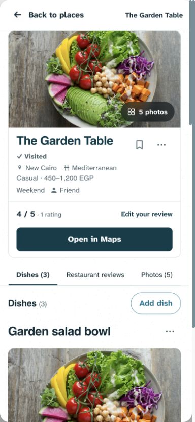
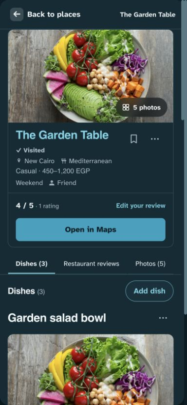
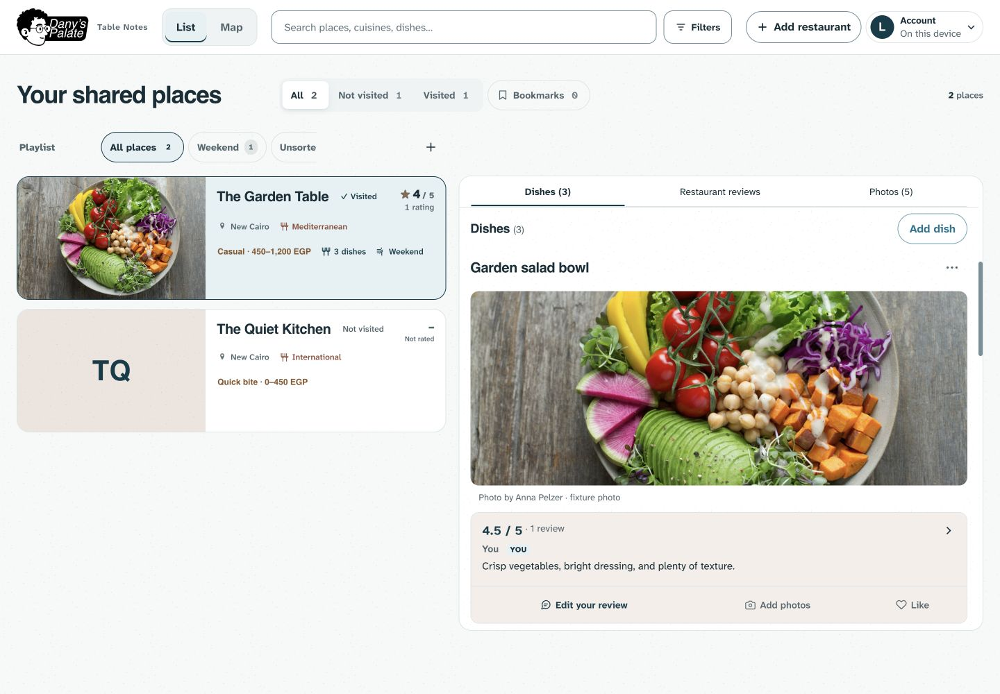
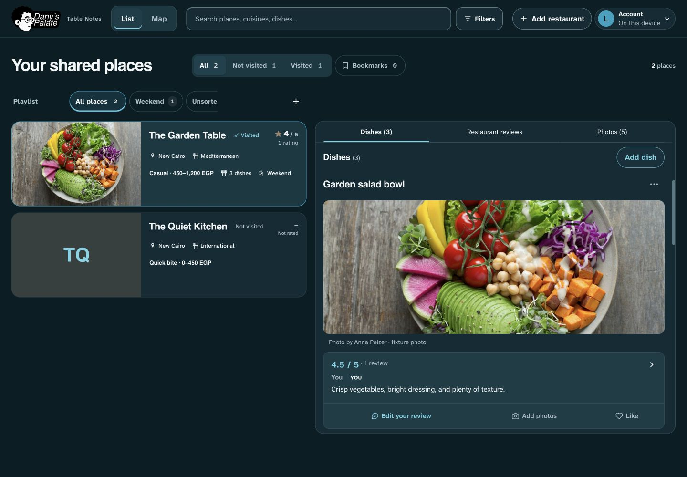

# Compact restaurant hierarchy and desktop density — 1 November 2026

**Implemented locally; not pushed or deployed.** Dany rejected the oversized/scattered restaurant header and the gap around the desktop Dishes / Restaurant reviews / Photos bar. This revises UI-03/07, preserving the large restaurant photograph restored in `31128f1` and all existing workflows.

## Findings

The header combined a name on its own row, visit/utilities on another, generous metadata spacing, then a three-line restaurant score beside a large review cell. The repeated Restaurant label and divided tonal cells made a simple score/action pair feel like a dashboard. The desktop section bar was constrained by the panel's inset content area, leaving scrolling imagery visible around it. Desktop list images also participated in intrinsic row sizing through an indefinite percentage height, allowing the photograph to make cards much taller than their text.

## Decision and implementation

- Preserve the full-width 16:9 restaurant photo, 180px minimum/320px cap, responsive sources, main-photo fallback and complete originals in the viewer.
- Use a 24px wrapping restaurant name with trailing Bookmark/More. Quiet visit status sits beneath; utility targets remain 44px. Compact initials retain the utilities on a second row so long names have sufficient width.
- Tighten identity/fact/context spacing using the existing 4px scale. Location, cuisine, price, playlists, visited people and quick-add actions remain; no information is discarded.
- Replace the divided rating cells with an approximately 53px row: score/count inline on the left, Add/Edit your review as a quiet text action on the right. Both controls keep 44px minimum height. The visual Restaurant label is hidden while the explicit accessible name remains Read restaurant ratings and reviews. The score still jumps to restaurant reviews; editing still opens the existing independent review dialog. No Maps slot is reserved when absent; existing primary Maps styling/destination stays.
- Share the detail gutter with the section bar: 16px, or 12px at ≤360px. The opaque 44px bar spans the panel's inner width. Remove desktop top padding and put the initial spacing on the restaurant header, so scrolling content cannot peek above the pinned bar. The mobile bar keeps its Back/safe-area offset. Desktop heading scroll margin becomes 64px to fit the smaller bar while preserving focus and active tracking.
- Desktop restaurant list photography fills the same 44% media region as before, but is positioned inside the stretched region so intrinsic image dimensions cannot inflate the row. The minimum remains 176px; long names/metadata can grow naturally. Initials keep matching geometry. Phone list imagery remains full-width 16:9 up to 320px high.
- Desktop list/dish names use 20px, dish review previews 14px; wide detail containers (≥600px) cap dish previews at 280px instead of 360px. Phone dish names, photo sizing and the large restaurant hero remain. No global font scaling or browser zoom change was introduced.

This is a refinement of Table Notes, not a new visual identity. It uses proximity, restrained type and one connected restaurant surface. No extra cards, blur, shadows, gradients or animation were added.

## Evidence and research

- [MDN positioning](https://developer.mozilla.org/en-US/docs/Web/CSS/Reference/Properties/position) describes sticky offsets in relation to the scroll container. The fix changes the actual panel/bar geometry instead of adding a scroll listener or browser-specific scroll-state feature.
- [W3C target-size guidance](https://www.w3.org/WAI/WCAG21/Understanding/target-size) supports keeping generous pointer targets while reducing visual weight. These compact controls retain at least 44px height; no universal accessibility conformance is claimed.
- Local DOM inspection at 1440×1000 measured panel top 253.25px and pinned bar top 254.25px: the difference is exactly the panel border. The bar spans the inner panel width, including its former content gutters.
- The fabricated 390px phone preview retained a ~344×194px hero. The information area became about 260px, including full metadata, review actions and Maps. A short desktop fixture card is 178px high; text can still grow a row when needed.

The Impeccable layout skill informed reading order and density. Its layout detector returned `[]` before and after. Source inspection explains the geometry; browser images and regression assertions verify the built result.

## Validation

- Build and syntax checks passed. `npm run check`: **158 tests passed**, 16 files.
- Relevant browser checks cover both themes, long names, missing photos/Maps, guest/permission controls, 320–1440px overflow, large hero/responsive sources, unchanged review/Maps actions, focus return, equal media regions and scrolling/jump behavior.
- New tests measure the compact score row, ≥44px controls, inline score/count, phone information height, desktop card height and flush sticky bounds at multiple scroll positions. Existing menu tests assert active section changes.
- The first focused run caught the real desktop heading-offset mismatch after reducing the bar; adjusting the CSS scroll margin fixed it. New test assertions were corrected to use Playwright's `y + height` bounds and preserve the existing last-visible-section indicator when a short page reaches its end. No navigation behavior was removed to satisfy a test.
- Final full Playwright run: **443 passed, 28 intentional skips, 1 failed** (2.5 minutes). Every header/layout/navigation case passed. The unchanged Maps cancellation test intermittently sent the restored draft URL when reopening the form; it also failed in 1 of 6 isolated repeated runs (5 passed). The earlier full run passed this Maps case. Its cause is unresolved; the broader suite is therefore not fully green. Maps form/resolution handlers were not modified, and no workaround was added to hide the failure.
- Final focused photo-layout/menu confirmation: **20 passed, 2 intentional skips**, including all new compact-header cases in both themes/device projects.

All automated records are disposable, with mocked/blocked remote responses. Visual previews use the repository's licensed Anna Pelzer photograph and fabricated records. No production data, schema, access, runtime setting or release changed. Physical Safari/Android, comprehensive screen readers and device-specific feel remain unverified.

## Captures

The loopback preview on port 4179 is a local review aid.
