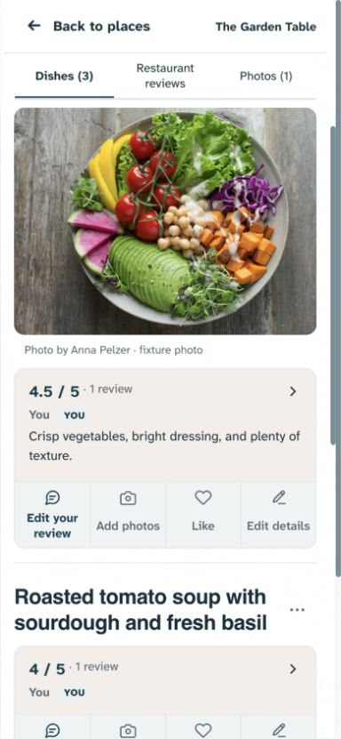
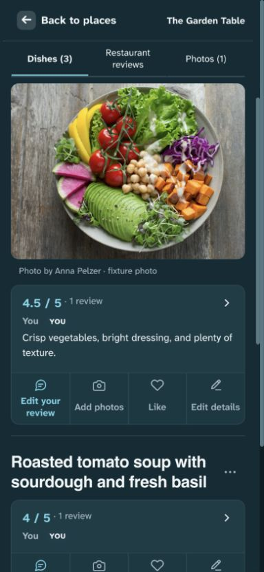
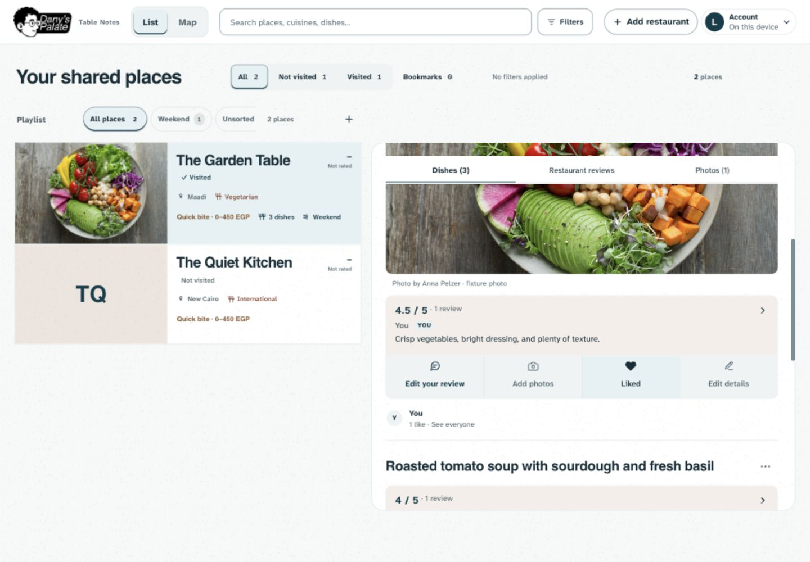
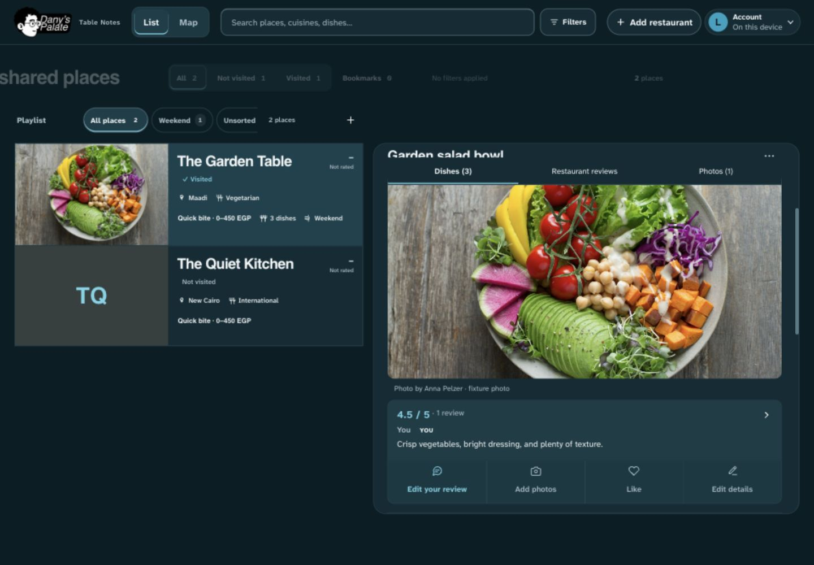
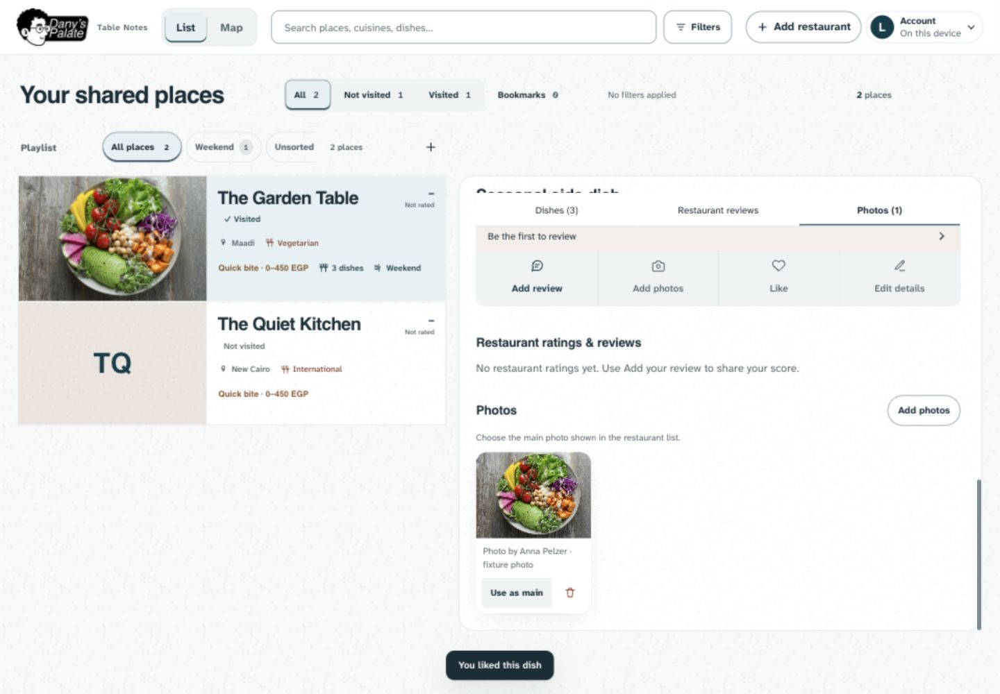

# Connected dish actions — 31 October 2026

**Implemented and verified locally; Dany authorized publication on 31 October 2026. Live verification is pending.** The previously verified frontend is `d9463c5`, with later documentation stamps possible. This work changes only dish response/action presentation and related regression assertions/documentation.

## Problem and decision

Dany's latest screenshot showed a taupe review summary followed by four disconnected controls in a loose two-row layout. The tonal review pill, underlined photo/details actions and isolated Like had competing shapes and weak grouping. More background texture would not resolve that structural problem.

The review and its commands now share one 12px boundary. The opinion retains its taupe light / raised-teal dark surface; an attached tonal action strip sits directly below. Four equal cells carry consistent 20px outline icons and full labels: Edit your review (or Add review), Add photos, Like, Edit details. The review label has stronger emphasis without a separate pill. Thin separators make the whole cell visibly actionable. Inline labels use a compact 14px role; button targets are at least 64px high and grow for wrapped text (76px in the inspected fixtures). Between-dish bottom padding decreases from 24px to 16px.

This explicitly supersedes UI-05's October 26 two-row arrangement and the initial October 31 underlined action refinement, following Dany's new screenshot feedback. Branding, fonts, photo size/crop and the rest of the restaurant hierarchy remain.

## Research applied

- [Nielsen Norman Group: common region](https://www.nngroup.com/articles/common-region/): shared boundaries strengthen perceived relationships when whitespace alone is insufficient. Applied to the review and its commands, rather than enclosing the entire dish/photo in another card.
- [Apple Human Interface Guidelines: toolbars](https://developer.apple.com/design/human-interface-guidelines/toolbars): group related commands deliberately, retain distinguishable targets, use consistent familiar symbols and avoid unnecessary overflow. The existing four actions remain directly visible.
- [W3C button pattern](https://www.w3.org/WAI/ARIA/apg/patterns/button/): retain native keyboard behavior, dialog focus return and a stable toggle name with `aria-pressed` for Like.
- [W3C toolbar pattern](https://www.w3.org/WAI/ARIA/apg/patterns/toolbar/): a semantic toolbar brings arrow-navigation/roving-focus obligations. This implementation uses a labeled `role="group"` with ordinary native Tab order; it does not imply a new toolbar keyboard contract.

## Preserved behavior

All existing action handlers, dialog destinations, full labels, review/photo drafts, retry paths, permissions, gallery and navigation ownership remain. Details editing still uses its separate name-only dialog and the accessible name “Edit dish details.” Whole-dish Trash remains in More. Like preserves its stable name, pressed/busy state, filled-heart feedback and retry errors. Account liker names/people popover and Earlier likes stay below the response panel; an empty metadata footer no longer reserves space.

Approved contributors who cannot manage the dish receive three equal-width cells, with no empty fourth slot. Guests receive the rounded review summary without an empty action strip. No access, data model, dependency, cloud configuration or schema changes were made.

## Validation and limits

- `npm run check`: **143 unit tests passed**, syntax checks passed.
- `npm run build`: passed after the final label/spacing changes.
- Full Playwright suite after final code/test changes: **415 passed, 27 intentional skips**, desktop/mobile Chromium. Fixtures and remote responses were disposable and mocked; no production test records were written.
- Updated organization checks cover one aligned strip, equal widths, minimum 44px targets, both themes, widths 320–1440, dialogs/focus and existing scoped accessibility checks. Contributor permission regression verifies three equal cells and no details/Trash access. Existing likes tests cover save/retry, account identities and legacy names.
- Final in-app browser inspection: 390 × 844 phone and 1440 × 1000 desktop, light/dark, photo with authored opinion, score-only and unreviewed panels; local Like visibly changed to Liked with filled heart and people metadata. Source fixes were limited to the compact label size and section spacing following the initial visual inspection.
- The loopback-only visual preview uses fabricated places and the repository's licensed Anna Pelzer salad fixture, with empty cloud configuration and remote access blocked. These captures are demonstration data, not Dany's production restaurant.
- Physical iOS/Android and comprehensive screen-reader testing remain unverified. Passing scoped accessibility checks is not a claim of universal compliance. Existing zoom-lock decision remains unchanged.

## Captures

The temporary preview is available on loopback port 4174 while its local server runs. It is not a published release.
