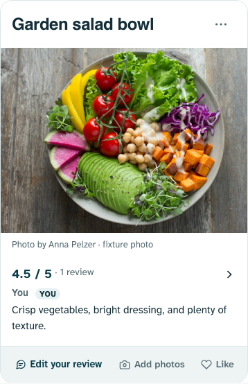
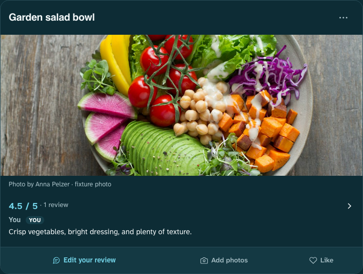
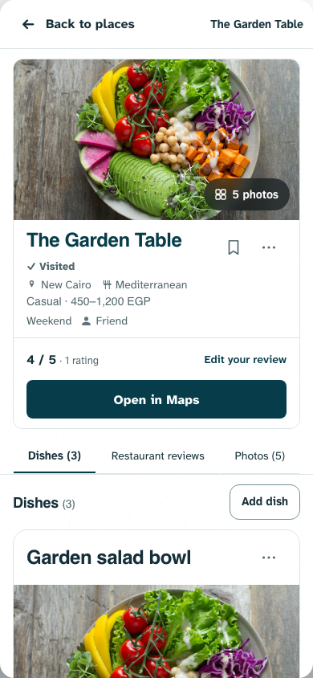
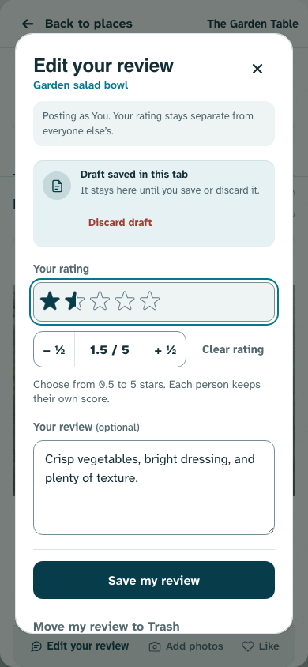
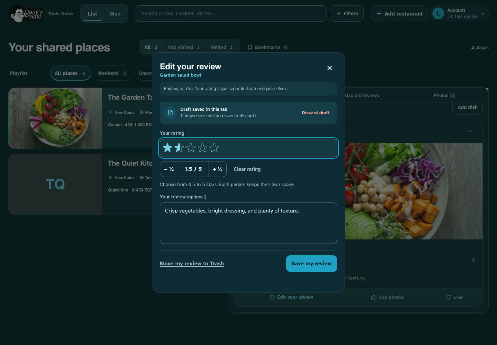

# Dish cards, restaurant spacing and rating contrast — 2 November 2026

Status: validated and pushed as `3124524` to `origin/design3.0` at Dany’s request. Post-push health was ok but still served `8a86a4e`; live rollout remains unverified. Dany requested three refinements, using the installed design skills. Impeccable’s existing product context, responsive guidance and craft floor guided the work. This preserves the established theme and large photos.

## Changes and rationale

- Each dish has one 18px rounded boundary around the title/More, photo/credit, rating/review, compact contribution row and likes. A panel background and 16px gap make separate dishes clear. The nested response border and gap are removed so review/actions belong to the image. This supersedes the earlier flat sections, 24px gaps and dividers. Cards are not whole-surface navigation targets: existing named actions retain their separate behaviors.
- A 12px margin above the restaurant identity/photo creates breathing room on first open without shrinking the image. It belongs to the header rather than the scroll container, preserving the flush sticky tab bar and mobile Back/safe areas.
- All four interactive rating pickers use visible outlined empty stars and solid theme accent selected stars on a subtle bordered surface. A stronger focus outline supports keyboard input. This scopes contrast changes to inputs; saved review stars and rating values are unchanged. Half-star clipping, tap/drag, arrow keys, Clear and save remain existing behavior.

No data model, permission, ownership, form, gesture or navigation code changed. Large filled photo crops and complete gallery originals remain. No-photo dishes omit media placeholders. Independent photo, review and metadata contribution workflows remain.

## Validation and limits

- Syntax and all **158 unit tests passed**; browser web-server build succeeded.
- Layout, organization, dish-shortcut and food-log browser cases: **123 passed, 9 intentional skips**. Navigation stability: **30 passed**. Coverage uses disposable local records and mocked/blocked remote responses, desktop/mobile Chromium, both themes, narrow/large layouts, review/photo actions, half-star input, carousel state, sticky tabs and background refresh/return context.
- Visual inspection covered phone light / desktop dark header, full dish card and rating picker using fabricated records and the licensed Anna Pelzer fixture. The final rating captures wait for the existing dialog animation to settle. Keyboard selection showed 1.5 accurately in both views.
- Existing checks were sufficient for this CSS-only refinement; no implementation-mirroring tests were added. Historical test-generated captures were restored; new evidence lives here.
- Physical Safari/Android gesture feel and comprehensive screen-reader testing remain unverified. No production data writes occurred; deployment remains unverified.

