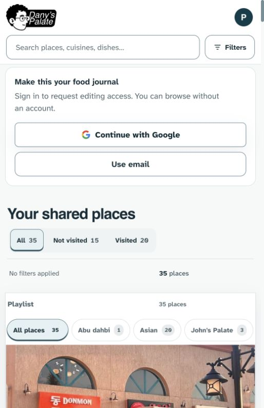
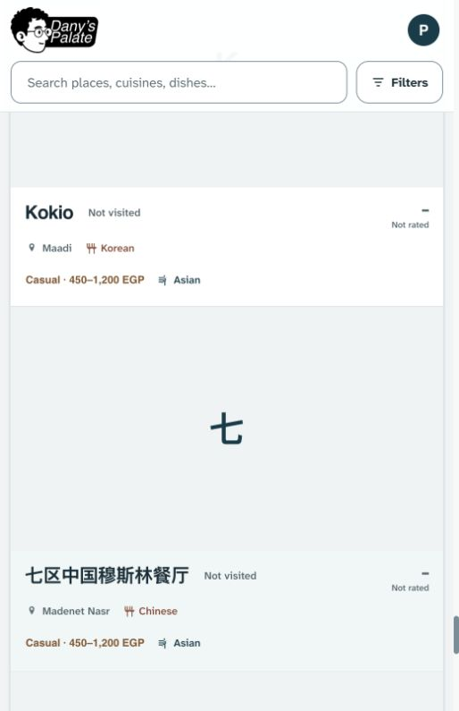
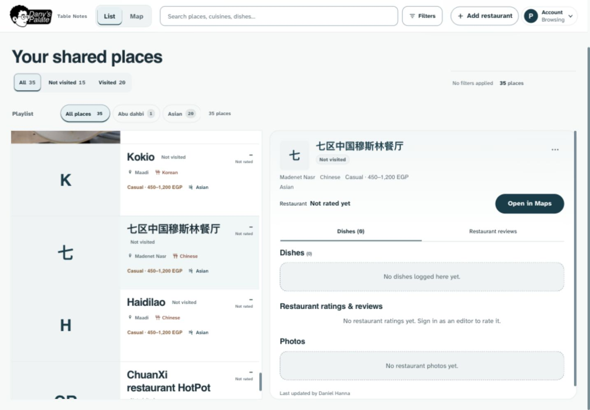
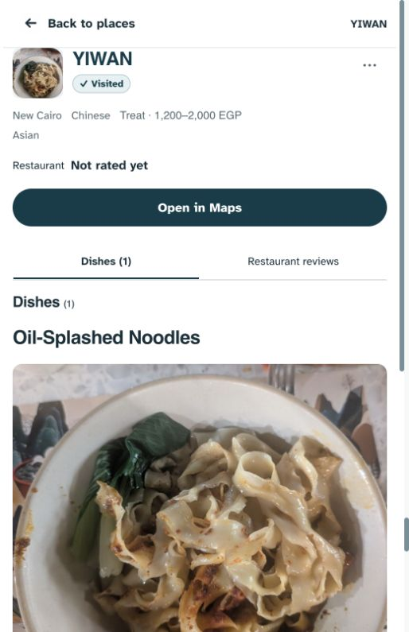
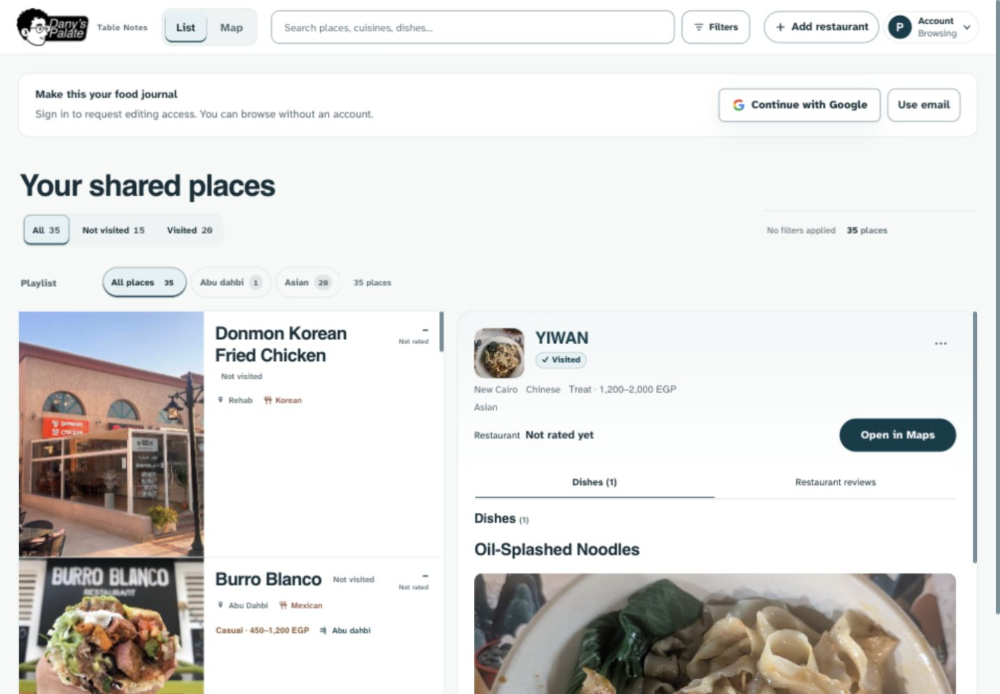
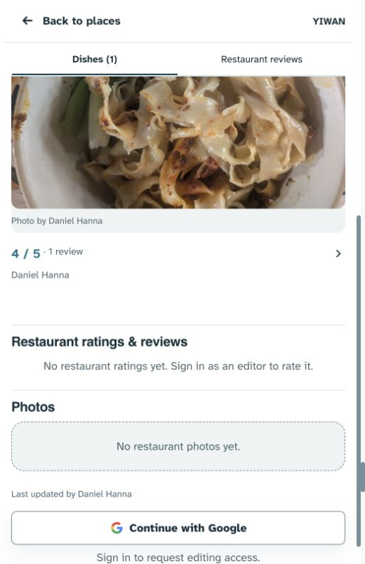
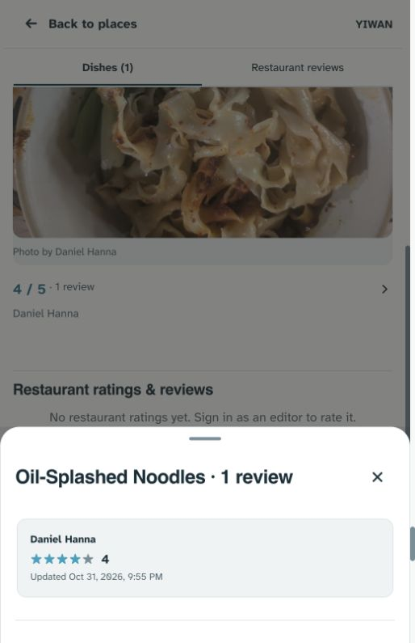
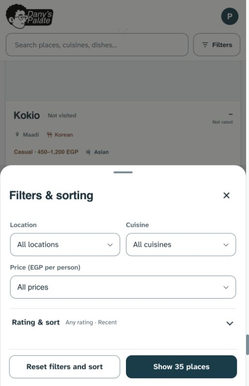
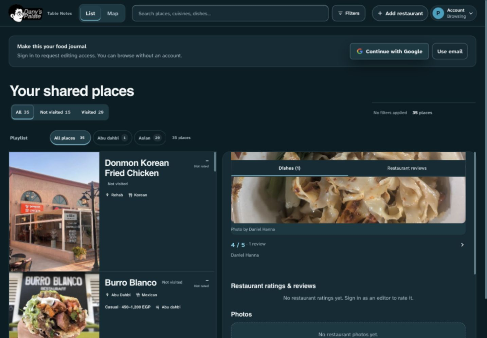
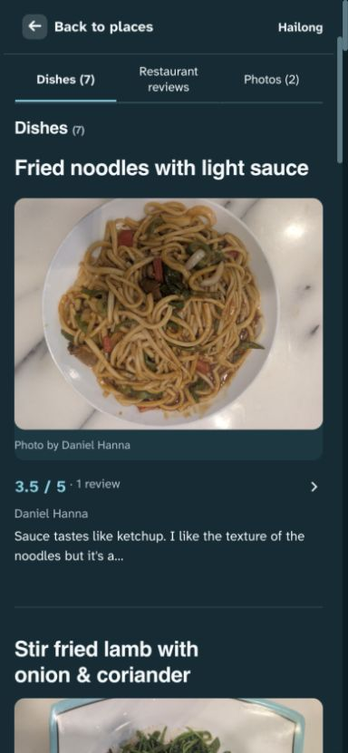

# FoodLog frontend audit — 31 October 2026

**Status at audit time: assessment and proposed direction only.** No application styling, functionality, production records, permissions, schema, or deployment changed during the audit. Sources: Dany’s supplied contributor screenshot, newly captured public production views, current source, project decisions/history, and primary design references. This is an expert inspection, not a user study.

**Follow-up:** Dany approved starting the first refinement later on October 31. See the [implemented local treatment and validation](IMPLEMENTATION.md); it has not been pushed or deployed. The findings below describe the original baseline.

The interface has a good foundation: a distinctive supplied wordmark, readable type, strong food photography, visible return navigation, and a restrained palette. Its weakness is that too many different things receive the same surface treatment. Photography supplies most of the warmth; areas without photography feel unfinished. The recommended refinement is **white ceramic surfaces with small taupe opinion regions**, retaining the existing identity and large photographs.

## Scope and evidence

User goal: find a place, see what friends ate and thought, and understand the available contribution actions. Inspected public browsing, a sparse restaurant, a populated seven-dish restaurant, review reading, filters, light/dark appearance, and desktop composition. Contributor controls were assessed from Dany’s supplied screenshot and source; authenticated creation, saving, and moderation were not exercised.

Captures 01–06 use the browser’s initial 514 × 795 viewport; 07–09 use 1440 × 1000; 10 uses 390 × 844. These are browser viewports, not physical-device tests. Capture 00 is the supplied 1080 × 2400 image. All accepted files were opened and inspected; a loading capture was rejected and removed. Public content was observed in place, not reused as automated-test fixtures or fabricated mockups.

| Step | Surface and general health | Evidence |
|---|---|---|
| 1 | Public entry — clear access explanation; account controls and several filter/count rows postpone the food. | 01 |
| 2 | Restaurant browsing — readable names/facts and consistent media geometry; missing-photo regions feel visually empty. | 05, 07 |
| 3 | Restaurant and dish entry — strong image and understandable navigation; several headings compete, while content surfaces merge. | 02, 08 |
| 4 | Dish summary and contribution area — readable score and visible contributor shortcuts; attribution, opinion, and action roles need a clearer relationship. | 00, 03 |
| 5 | Review reading — clear close control and contained review; score-only content is correctly preserved. | 04 |
| 6 | Filters — sound hierarchy and a clear final action; keep this surface visually quiet. Escape returned focus to Filters in the observed check. | 06 |
| 7 | Dark and populated content — useful tonal depth and real opinions; opinion blocks still blend into the surrounding dish stream. | 09, 10 |

### 1. Public entry

Strength: the wordmark already gives the product a recognisable identity. Risk: on this guest viewport, the first restaurant photograph starts around y=673. Sign-in, the browse heading, status choices, applied-filter feedback, counts, and playlists all precede it. A returning editor sees a different access state; do not generalise this measurement to every account. Keep all entry points and filtering capabilities, but explore tighter spacing and a more compact account-access composition in a later pass. Do not add another decorative hero.

### 2. Restaurant browsing and sparse content

Strength: names wrap and metadata remains separate from media. Risk: large, almost uniform placeholders turn sparse records into slabs of empty colour. This is a material-treatment opportunity, not permission to undo the equal-size media decision. Preserve full-width phone / 44% desktop media regions, square outer corners, initials, and existing image crops. A restrained current-palette ceramic treatment can give these regions intention without inventing restaurant imagery. The dashed empty dish/photo panels also resemble unfinished upload slots; a calmer empty-state treatment can retain the messages and available actions.

### 3. Restaurant and dish entry

Strength: Maps is a clear main action and the dish photograph has presence. Risk: the restaurant heading, section navigation, repeated Dishes heading, and dish title create several consecutive visual starts. Preserve the section headings and navigation semantics; make section labels/counts subordinate and let the dish name carry the content hierarchy. Desktop also spends substantial vertical space on browse chrome before the detail stage. Address that separately from the dish treatment so the first refinement stays bounded.

### 4. Dish summary and contributor actions

Contributor evidence: [Dany’s supplied screenshot](00-user-contributor.png).

Strength: the photo is appealing, attribution is explicit, the score opens full reviews, and contribution shortcuts remain visible. Risk: the cool photo-credit strip gets a distinct surface while the actual opinion has none. The rating, person, and controls consequently read as separate leftovers beneath a photo. In the supplied contributor view, Edit your review is clearly a button, while Add photos, Like, and Edit details rely more on text position to communicate interactivity. Preserve their two aligned rows and emphasis order; strengthen the text-action cue and keep 48px contribution / 44px reaction-edit targets.

Important measurement: the live dish heading is 24px and the photo credit is 13px. The enlarged phone screenshot is not evidence that the CSS typography is oversized. Improve relative emphasis, alignment, and grouping before shrinking text or photography.

### 5. Full review reading

Strength: the sheet identifies the dish, retains the author and score, and has a visible close control. Risk: the same cool utility fill is also used for review content, weakening the distinction between a person’s opinion and app chrome. A small taupe review surface is worth previewing. The reviewed dish has a score without written prose; do not manufacture a quotation, tasting description, visit date, or other content to make it feel richer.

### 6. Filters

Strength: visible labels, restrained fields, advanced Rating & sort disclosure, and a clear Show places action. This is already the right kind of restraint for a task surface. Avoid grain in fields or extra material effects here. In a targeted keyboard check, Escape closed the sheet and focus returned to `filterButton`; the 390px browse check had no document-level horizontal overflow. These checks do not establish full keyboard, screen-reader, or accessibility compliance.

### 7. Dark and populated content

Strength: the existing deep teal and raised surfaces work; food photography retains warmth. Actual written opinions give the populated restaurant more personality than the score-only example. Risk: a transparent opinion summary sits on the same background as the rest of the stream, so it lacks a distinct reading region. Use tonal separation in dark mode first. Historical decisions deliberately removed dark gradients and texture; a light-theme material experiment should not automatically restore either in dark mode.

## Findings and priority

Priorities indicate refinement order. P2 means a meaningful clarity/consistency issue with an available path; P3 means visual polish. No blocking task failure was established in the inspected flow.

| Priority | Finding | Why it feels bland / what to change | Evidence |
|---|---|---|---|
| P2 | Content roles share one plane | Distinguish page canvas, food/content surface, and personal opinion through existing semantic colours and proximity. Keep large reading surfaces white. | 03, 08, 10 |
| P2 | Photo credit is better bounded than the opinion | Keep credit attached below the photo with a consistent horizontal inset; group score, review count, author and actual prose as one modest note region beneath it. | 00, 03, 10 |
| P2 | Secondary actions have weak visual affordance | Keep the current two-row layout; give Add photos a consistent text-action treatment and align Like / Edit details as utilities. Do not make every action a filled button or move them into More. | 00 and current CSS/source |
| P2 | Sparse content looks unfinished | Preserve media geometry and initials; refine its surface. Retain empty-state information and contribution paths while reducing the visual weight of dashed empty boxes. | 05, 07 |
| P3 | Spacing loses its rhythm | Use 8–12px inside an opinion, 16px to its action group, and 24–32px between dishes/sections as starting values. Audit accumulated padding and gaps rather than reducing every gap uniformly. | 00, 03, 10 |
| P3 | Repeated headings and utility chrome compete with the food | Keep Helvetica/Atkinson; make section labels and counts quieter than dish names. Tighten guest/browse chrome after the dish pass. | 01, 02, 08 |

## What the code and history explain

- **Texture is disabled, not missing.** `styles.css:7571` and `:7631` set `--food-surface-texture: none`; the dark override at `:8938` does too. Both ceramic assets still exist and are in the service-worker precache (`sw.js:32`). The live computed detail background confirmed no grain; the light view retains a subtle top wash, and dark has no background image.
- **Chronology matters.** Ceramic material was introduced in September and re-enabled on September 21. Dark grain was removed in the October 3 revisions; the October 4 palette decision explicitly retained flat dark surfaces without gradients. Commit `65b6eea` on October 12 changed the remaining light texture URL to `none` during the chosen teal/taupe palette update. This is not evidence of a failed asset request. Reintroducing light texture is a new refinement proposal under Dany’s present request.
- **Dish depth and opinion surfaces are explicitly flattened.** `styles.css:9871` onward makes dish cards transparent with no shadow; `:9890` also makes the review summary transparent with no resting boundary. The photo credit inherits `--panel-soft` through `.dish-gallery-cover` (`:9899`) and uses `padding: 8px 0` (`:9901`). These explain the visible separation imbalance.
- **The content already exists where authored.** `app.js:5574` renders photo → score/opinion → contributions → likes/details. `app.js:5610` renders the author and optional real review snippet. Refine this structure; do not invent content or rebuild the app to solve a presentation problem.
- **The documentation conflicts.** `DESIGN.md:184` says matte surfaces without ceramic texture; `:326` still instructs ceramic grain in both themes. Its overview also contains older charcoal/bronze descriptions. Current memory, later palette decisions, and rendered CSS establish the actual baseline. Flag this drift now; reconcile the spec with whichever visual treatment Dany selects.
- A supporting Impeccable scan of `index.html` returned **31 advisories**: 21 border/shadow, 6 radius, 3 palette, 1 repeating-stripe. These have coarse locations and can include overridden styles or documented role exceptions. They are not 31 verified live defects and do not justify changing the selected fonts, square restaurant rows, or every control radius.

## Research applied

Research was used to explain the observed weaknesses and constrain the solution. It does not prove that a particular texture will improve this product; that needs a visual comparison and user feedback.

| Primary source | Relevant principle | Application to FoodLog |
|---|---|---|
| [NN/g — Five visual-design principles](https://www.nngroup.com/articles/principles-visual-design/) | Relative scale, contrast and balance establish the reading order. | Dish names, section labels, scores and utility controls need different emphasis within the chosen type system. |
| [NN/g — Proximity](https://www.nngroup.com/articles/gestalt-proximity/) | Nearby elements are perceived as a related group. | Keep the image credit with its image; keep score, author and prose together; separate the management actions deliberately. |
| [Material Design — Colour roles](https://m3.material.io/styles/color/the-color-system) | Surface and container roles support hierarchy, with paired foreground colours. | Give canvas, content and opinion distinct roles using the existing palette. This is a principle, not a recommendation to adopt Material components. |
| [Beli — Official product overview](https://beliapp.com/) | Its stated purpose centres on organised restaurant lists and friends’ opinions. | Useful category context: FoodLog’s character should come from actual places, dishes and people. Only its public positioning was researched; its authenticated app was not audited. |
| [W3C — Minimum text contrast](https://www.w3.org/WAI/WCAG22/Understanding/contrast-minimum.html) | Normal text needs at least 4.5:1; qualifying large text needs 3:1. | Check the final composited surface after adding grain/tints, including captions and secondary actions. |

## Recommended first refinement

Start with **one complete dish entry and its section transition**, in light and dark, with photo + score-only, photo + written review, and no-photo content. Use disposable fabricated records and existing licensed fixture photography if building a preview. Do not clone production content into fixtures.

| Role | Recommended starting treatment |
|---|---|
| Page canvas | Retain the existing near-white `#F7F8F8`; preview a very faint current-palette ceramic grain in limited light-theme regions. |
| Food/content | White `#FFFFFF`, clear photographs, existing photo radius/crops. A single subtle boundary only where it explains grouping. |
| Personal opinion | Try the existing taupe surface `#F4EEE9` and paired readable text, with 12–16px internal padding. Keep score-only notes compact. Avoid another enclosing card around the entire dish. |
| Photo credit | Retain real attribution below the photo; align it with a small consistent inset and reduce the dominance of the cool footer fill. |
| Actions | Preserve Review / Photos then Like / Edit details, current permission rules, targets and emphasis. Clarify text actions; keep the main restaurant action role. |
| Dark | Preserve deep teal, no gradient/glow; preview a modest tonal opinion region. Leave grain off in the first pass. |

The old light ceramic asset uses a retired green tone (`#174A3B`) with very small low-opacity marks. Reusing it unchanged may be imperceptible or revive the previous palette. If retained, adapt its colour to the current teal/taupe roles and inspect at 100% on a real phone. Grain should feel like a material, without visible repeat seams, shimmer, or interference with text. Keep controls, photographs, print, and forced-colors mode clear.

Retain decisions UI-01–05, PHOTO-04, NAV-02/03 and FORM-07: supplied branding, Helvetica/Atkinson, white/teal/taupe identity, photo-led order, equal missing-photo media geometry, visible contributions, full original galleries, permissions, navigation and gesture ownership. Avoid a framework migration, new font system, ornamental badges, invented review content, or decorative motion in this first pass.

## Acceptance and limits

For an implementation, compare before/after at 390px and desktop in both themes, plus a narrow 320px layout. Verify photo and no-photo states, real long names, rating-only/written reviews, focus/hover/pressed states and target sizes. Use mocked remote responses; confirm review/photo/detail actions, gallery access, Back/scroll restoration, and reduced motion. Recheck contrast against the composited materials and preserve forced-colors/print handling. A texture change should require no animation or new framework.

This audit verified selected rendered styles, review-sheet entry/close, section navigation, filter entry/close and one Escape/focus-return check. No complete accessibility, physical iOS/Android, screen-reader, performance or authenticated save audit was performed. No runtime tests were run because runtime code did not change. Light appearance and the browser viewport were restored after inspection. All visual recommendations remain proposals.
