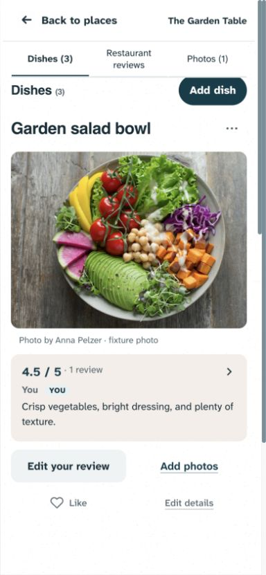
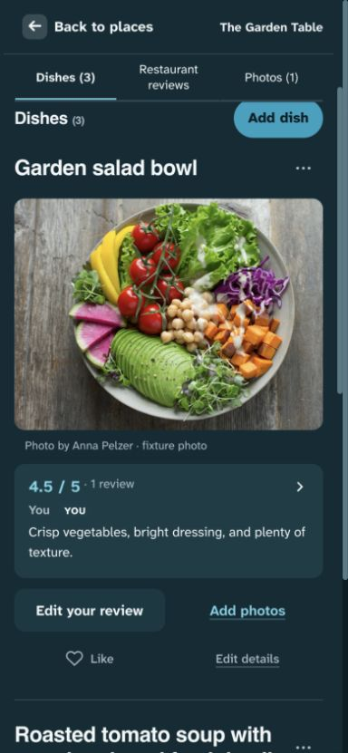
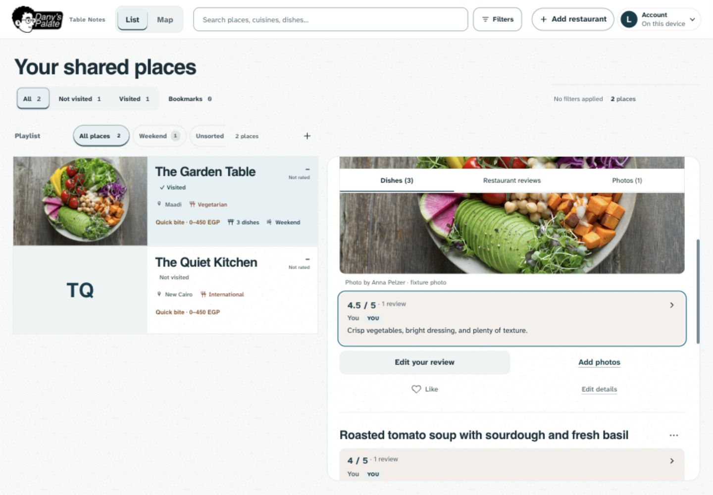
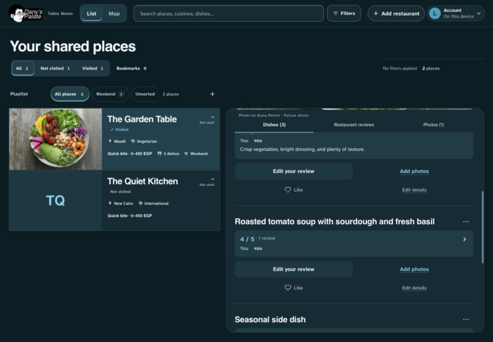

# Ceramic and opinion refinement — 31 October 2026

**Implemented locally; not pushed or deployed.** Dany approved starting the audit’s recommended first refinement. The implementation stays in the current white/teal/taupe identity and existing vanilla stack. The original [audit](AUDIT.md) is a dated baseline, not the current implementation status.

The dish view now groups score, author and optional prose in one quiet opinion region: taupe in light mode and raised teal in dark mode. Photo attribution uses the plain reading surface with a 12px inset. Related gaps are tighter, authors are slightly stronger, and Add photos / Edit details have underlines. The aligned contribution/utility rows, 48px contribution and 44px utility targets, existing headings/fonts, filled photo previews, complete galleries and all actions remain.

Light canvas, detail and existing placeholders use the retained 144px ceramic vector tile, recoloured to current teal/taupe with modestly more visible marks. Photography, controls, opinion regions and dark mode stay smooth. The old light detail gradient is replaced by the ceramic canvas. Print and forced-colors omit texture, including the phone drawer’s more-specific selector. No new animation, dependency, application JavaScript, data format or permission was introduced.

This supersedes the light grain-off setting from the October 12 palette update and the transparent opinion summary from the organized-menu revision. It preserves the reasons for the existing photo-led layout, equal missing-photo media regions, two aligned action rows and smooth dark theme. DESIGN now describes that decision consistently; unrelated legacy design-system sidecar advisories remain outside scope.

## Validation

- `npm run check`: **143 unit/source checks passed**; JavaScript syntax checks passed.
- Build passed with local development stamps.
- Restaurant organization, photo-led layout, restaurant menu, dish shortcuts and dish likes: **50 browser checks passed, 2 intentional platform skips**, across desktop/mobile Chromium and both themes. Existing checks include 320–1440px geometry, named controls, permissions, review/photo/detail workflows, recovery, gallery originals, focus return and scoped axe contrast/ARIA/name rules.
- Gallery zoom and mobile photo swipes/vertical scrolling: **4 passed, 2 desktop-only touch skips**. Touch coverage uses emulation, not physical hardware.
- The initial browser pass caught hover-contrast failures in the score/You badge. The final pass uses paired foregrounds and a gentler hover tint; all focused contrast checks pass. A phone drawer shorthand also initially suppressed grain and was corrected without altering drawer opacity or gesture ownership.
- In-app browser inspection used fabricated records and the existing licensed Anna Pelzer photograph, with remote connections blocked. Accepted final captures cover light/dark phone (390 × 844) and desktop (1440 × 1000), written/score-only/no-photo content and visible action rows. A full-review open/Escape check returned focus to the originating opinion block. Unsettled/incorrect-theme captures were rejected and replaced.
- Manual detector: **31 advisories**, the same rule counts as the baseline (21 border/shadow, 6 radius, 3 palette, 1 stripes). These coarse existing source advisories are not 31 confirmed live defects. No extra polishing loop was run.

No production records were used as fixtures or modified. Authenticated production saves, physical iOS/Android, full screen-reader coverage and a formal usability study remain unverified. Automated fixture checks do not establish universal accessibility or production deployment.

## Final local captures

The temporary preview serves only loopback port 4174 from `/private/tmp/foodlog-material-preview.mjs`, supplies empty cloud configuration, and seeds only its own browser origin with fabricated records. It is a review aid, not a production server. Stop the recorded preview command/session when it is no longer needed.
