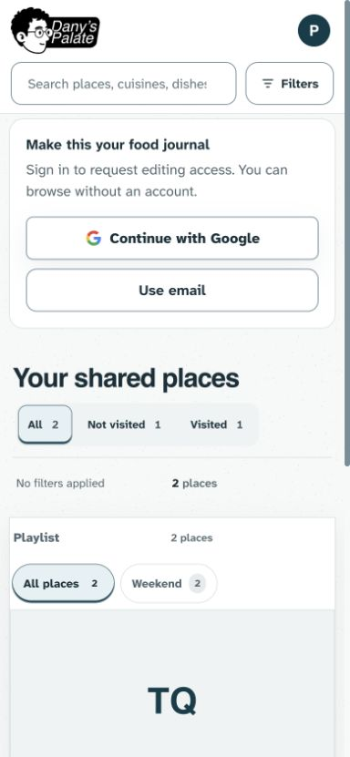
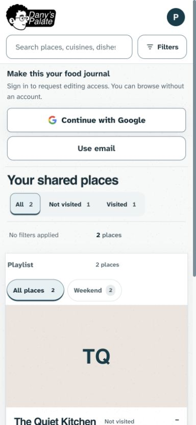
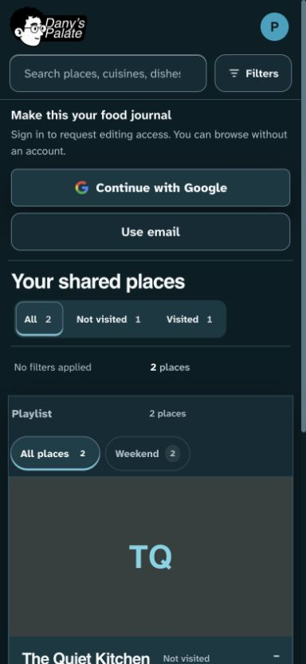
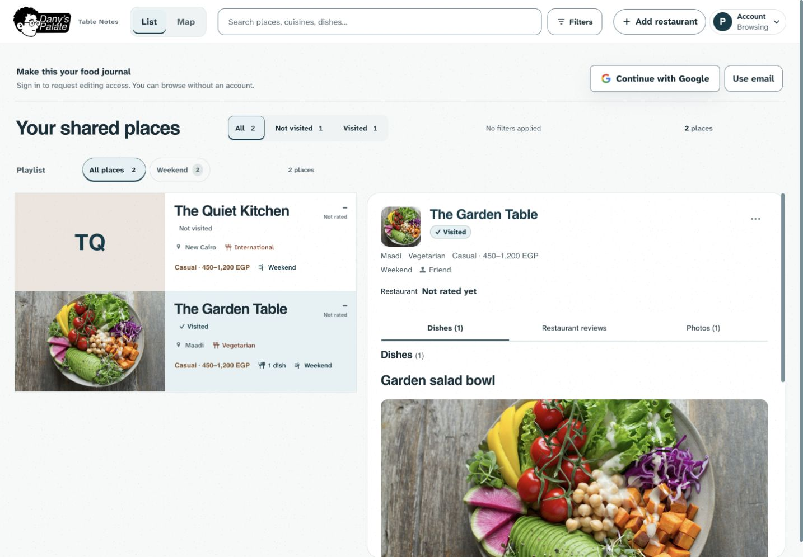
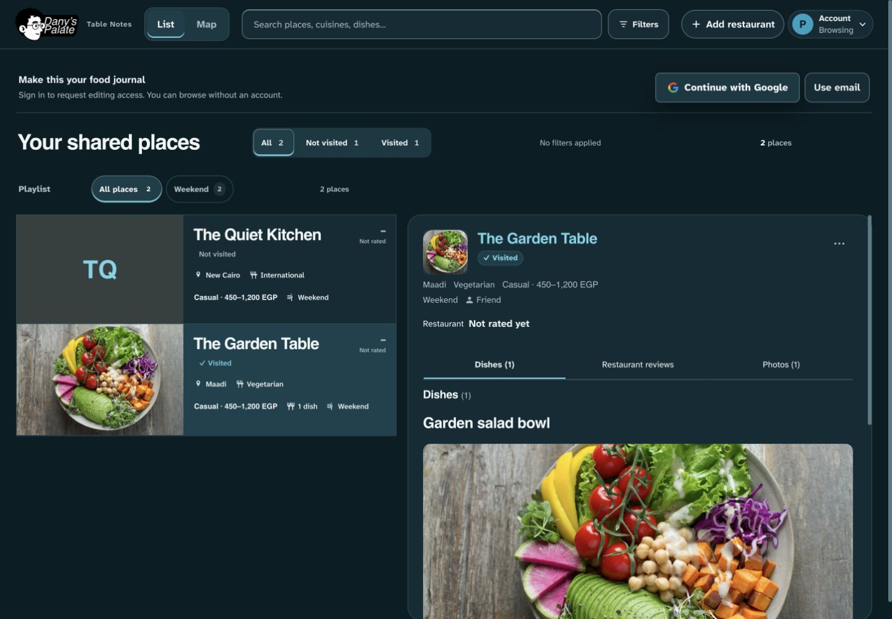
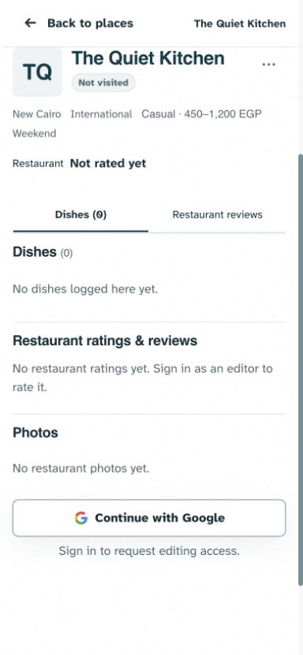
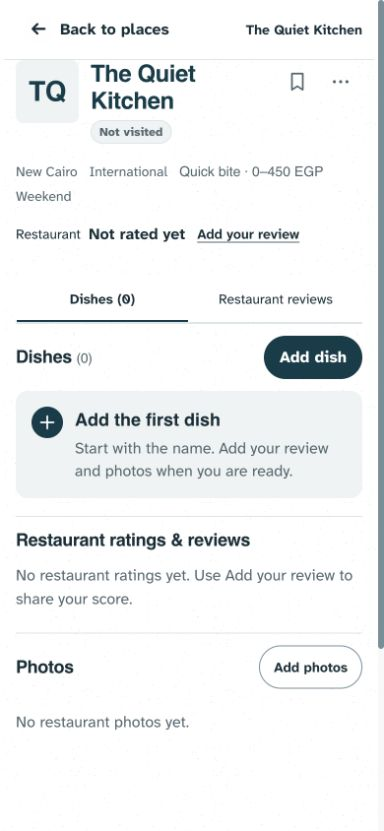
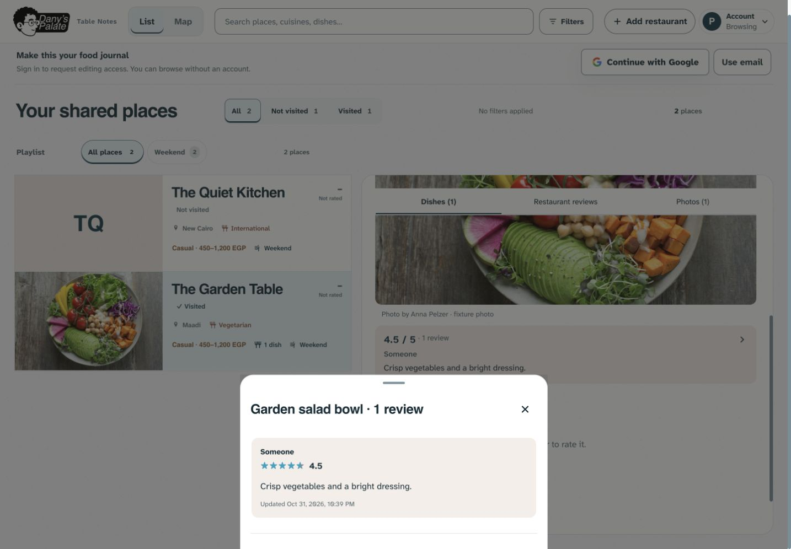
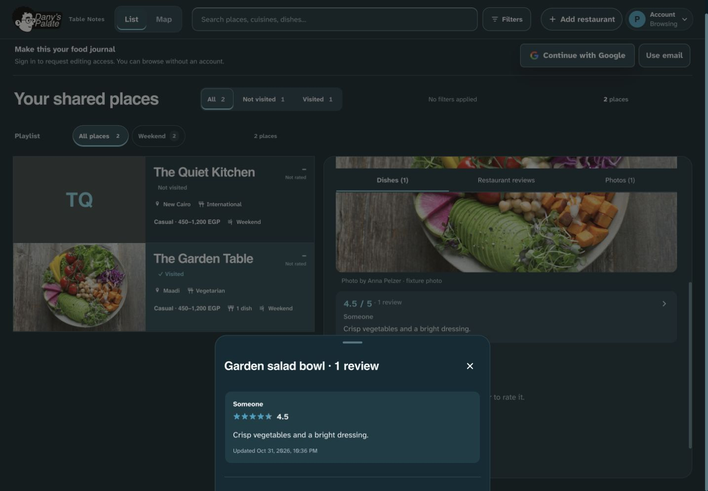

# Remaining frontend audit refinements — 31 October 2026

**Implemented locally; not committed, pushed or deployed.** Dany asked to continue the remaining improvements after the first material/opinion pass shipped as `6815a2f`. This follow-up addresses the outstanding browse, sparse-content, hierarchy, empty-state and review-reading findings from the [audit](AUDIT.md). The first pass’s [publication evidence](IMPLEMENTATION.md) remains historical and does not establish deployment of this follow-up.

## Changes

- Public access now reads as a compact strip with a lower separator and smaller supporting copy. Google, email, approval checks and errors retain their existing entry points, permissions and startup rules. Phone sign-in actions remain stacked, full width and at least 48px high.
- The browse title is subordinate to content at 26–36px. At ≥1280px, heading, visit controls and filter feedback share one horizontal band. Smaller layouts stay stacked. The applied-filter rail is 52px, consistently reserved with no filtering-induced list movement; counts, Update order, playlists, Show all and creation/management slots remain.
- Missing restaurant photos keep the shared media geometry and 40px initials, using the current warm media colour and light ceramic grain instead of a flat utility fill. Dark remains smooth. No imagery, factual content or attribution is invented.
- Dishes, Restaurant ratings & reviews and Photos have quieter 18px section titles. Dish names remain 24px. Actual H3 targets, sticky section navigation, focus, deep links and scroll-return ownership are unchanged.
- Passive empty dish/photo states use plain left-aligned copy rather than dashed boxes. The interactive Add the first dish surface keeps its whole-button target, icon, title and helper text, arranged compactly side by side. Other Add dish/review/photo entry points remain.
- Full dish reviews now share the opinion surface used by the dish summary: taupe in light mode, raised teal in dark, regular-weight prose and paired own-review badge colours. Authorship, scores, timestamps, actions, moderation and selectable prose remain.

Only CSS and documentation changed. No application JavaScript, database, permissions, dependencies, actual content or production settings changed. UI-01–06, PHOTO-04 and the navigation/draft contracts remain constraints. This refines the selected design rather than replacing the fonts, branding, large photographs or workflows.

## Evidence and validation

At the same 390 × 844 requested phone viewport, the first restaurant’s media top moved from **680.47px to 606.58px** (about **74px earlier**). Guest access decreased from 234.5px to 199.5px and the browse header from 169.97px to 155.08px. These measurements use fabricated guest records; they are not universal measurements for every account or text length. The document’s 384px client width excludes its scrollbar. At the inspected 1440 × 1000 desktop viewport, the header occupies 62px and the first restaurant starts at 347px. No matched desktop before/after height claim is made from the initial, differently sized desktop capture.

- `npm run check`: **143 passed**, with syntax checks passing. Build passed.
- Full browser suite: **415 passed, 27 intentional skips** across desktop/mobile Chromium. It covers guest/approval/signup, filter and playlist geometry, navigation/history/taps/swipes, capture/recovery, galleries, contribution actions and existing scoped accessibility checks. No failures occurred.
- After the final placeholder texture cascade correction, the focused photo/no-photo suite passed **9 checks, 1 platform skip**, including media geometry and contrast/name/ARIA checks.
- A separate final media-mode check passed **12 combinations**: normal/forced-colors/print × light/dark × phone/desktop. It verifies light grain is present where intended and decorative backgrounds are absent in print/forced-colors. This caught a legacy dark phone gradient with a stronger selector; the root-qualified dark rule now retains the already-chosen flat treatment, including hidden/print detail states. No visible-state layout changed after those focused checks.
- In-app browser captures inspected phone and desktop, both themes, public browsing, contributor empty states and full reviews. Opening Add the first dish reached the existing capture form; Escape restored focus to the initiating action. Review-sheet Escape also returned focus to its summary. The visual pass comprised one batch and one confirmation after the texture correction.
- The supporting mechanical scan retained the baseline's 31 advisories (21 border/shadow, 6 radius, 3 palette, 1 stripes); they are coarse existing source signals rather than confirmed new live defects.

All automated data is disposable and remote responses are mocked or blocked. The local visual preview has fabricated records, the existing licensed Anna Pelzer fixture photograph, empty cloud configuration in editor mode and a mocked anonymous client in guest mode. It sends no requests to production. Physical iOS/Android, comprehensive screen-reader testing and authenticated production saves remain unverified; this work does not establish universal accessibility compliance.

## Completion scope

The concrete presentation recommendations from this audit are implemented across the first and remaining passes: surfaces/texture, opinion grouping, photo credits, action cues, browse density, missing-photo treatment, section hierarchy, empty states and full-review styling. No further visual change is currently planned from this audit.

Outstanding work is verification and feedback: physical iOS/Android, a complete screen-reader/keyboard accessibility review, and observing real use. The 31 mechanical advisories remain coarse legacy signals that would require individual review in a separate design-system/code cleanup; they are not 31 established defects or blockers to this refinement. Another visual pass should follow concrete usability feedback rather than an open-ended decoration backlog.

## Captures

The temporary loopback-only preview runs on port 4175 from `/private/tmp/foodlog-browse-preview.mjs`. It is a review aid, not a deployment. The original differently sized desktop baseline and the desktop contributor capture are retained as supporting evidence in `remaining/`, not matched comparisons.
