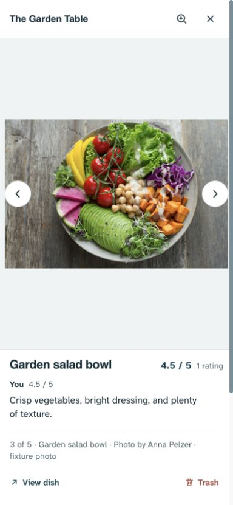
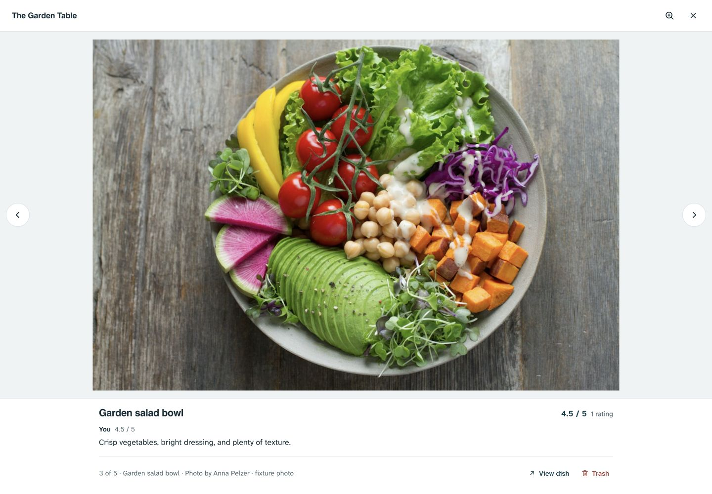
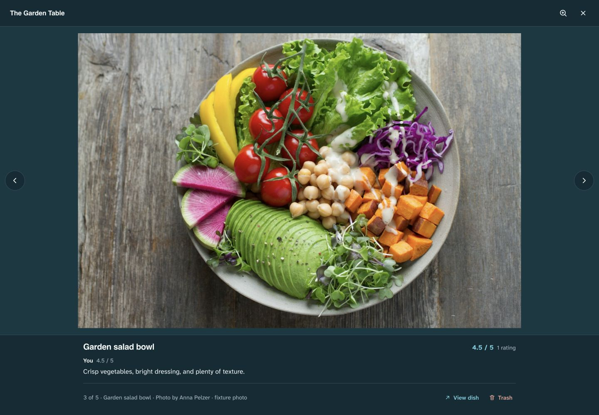

# Photo review disclosure and dismissal — 1 November 2026

**Implemented and verified locally; not pushed or deployed.** Corrects Dany's report that Read full review repeats text already visible, and swipe-down leaves the review/actions behind the moving photograph. PHOTO-02 is revised; the library, review data, management permissions and quiet View dish navigation remain.

## Findings and decision

The previous renderer offered a disclosure for every written review, regardless of actual clipping. The previous gesture translated/scaled only the image and reduced the entire shell's background alpha. The footer stayed stationary while becoming transparent over the photo library, producing the overlapping text shown in Dany's screenshot.

For a single review, measure the actual two-line preview after layout. Offer Read full review only if `scrollHeight > clientHeight + 1`; avoid a character-count heuristic because font metrics and viewport wrapping determine what fits. Recheck after resize, context size changes and font readiness/loading. Keep an open reader open during resizing; re-evaluate when collapsed. Expanded disclosures say Show less. Multiple ratings retain Read all reviews because additional opinions exist even when the preview fits. Score-only and unrated behavior stays unchanged.

Treat the viewer as one physical surface. A downward drag from the unzoomed image translates the opaque shell, including header, image, review, credit and commands. The library appears only in the area uncovered by the moving surface, under the existing modal backdrop. There is no image-only shrink or background-alpha fade.

Release rules:

- A drag beyond 110px, or a downward flick above 650px/s after at least 35px, commits dismissal. Upward release intent below -250px/s cancels even beyond the distance threshold.
- A short/cancelled drag settles home; a committed drag carries the shell offscreen before closing and returning focus.
- Release uses a 280ms critically damped transform animation, seeded with recent release velocity. Re-grabbing reads the current presentation transform before cancelling the old animation, so the surface does not jump. Cancelled completions cannot later close a newly grabbed/navigated viewer.
- Downward/horizontal intent is locked after movement begins. Zoomed drags pan; a second finger cancels dismissal and begins pinch. Review scrolling stays native and separate. Trash confirmation and pending saves block new dismissal gestures.
- Reduced motion retains direct finger feedback and skips release travel. Close/Escape and existing photo navigation remain available.

No motion library, new data access, schema change or image transformation was added. Observer, font, resize, animation and timer ownership is cleaned up on close/remount. Photo changes and saves cancel pending dismissal.

## Research applied

- [Apple, Designing Fluid Interfaces](https://developer.apple.com/videos/play/wwdc2018/803/) informed continuous direct manipulation, interruptibility and preserving motion on handoff. Moving the entire shell is the project-specific design decision, checked against Dany's screenshot and the current reader layout.
- [MDN, Element.scrollHeight](https://developer.mozilla.org/en-US/docs/Web/API/Element/scrollHeight) documents measuring content height including hidden overflow; the implementation compares it with visible client height after layout.
- [MDN, Animation.finished](https://developer.mozilla.org/en-US/docs/Web/API/Animation/finished) documents the completion promise. Cancellation is handled, and completion identity is checked before closing to prevent stale animation work winning after interruption.

The animate and Apple-design skills guided the motion implementation. This research supports the interaction mechanics; it does not prove a universal aesthetic preference or physical-device frame rate.

## Validation and limits

- Build passed. `npm run check`: **158 tests passed**, 16 files, plus syntax checks.
- Final uninterrupted full Playwright run: **440 passed, 28 intentional skips** across desktop/mobile Chromium (2.6 minutes). Disposable local records and mocked/blocked remote responses only.
- New browser regressions cover a fully visible single review, clipped single review, Show less, narrow/wide/narrow wrapping, reopening, light/dark opaque surfaces, equal header/image/footer drag movement, short/cancelled returns, committed exit/focus return, interruption/reversal without late close, pinch takeover, zoomed panning, separate reader gestures, reduced motion and Trash-confirmation guards.
- The native phone-touch test passed in the final suite and in three repeated isolated runs. Its initial assertion read the transform before Chromium delivered the final coalesced pointermove; it now waits for that observable position before releasing. No application workaround was needed.
- Live browser inspection covered 390×844 and 1440×1000 in both themes. Direct drag returned to the library with the selected tile focused. Native motion and real WAAPI are covered by browser tests; physical Safari/Android feel, comprehensive screen readers and production failure paths remain unverified.

Existing main-photo choice, recoverable Trash, photo-to-dish conversion, author/photographer distinction, complete originals, paging, zoom resets and read-only review semantics passed their regressions. No production data, account setting or release changed. Local preview uses loopback port 4178 and fabricated records with the licensed Anna Pelzer fixture.

## Captures

