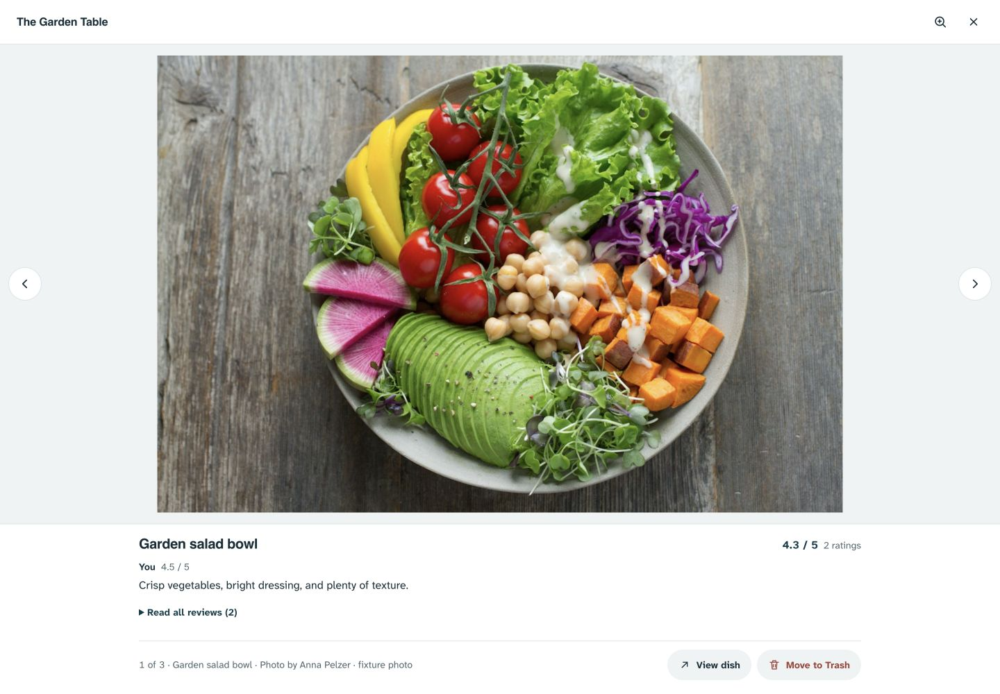
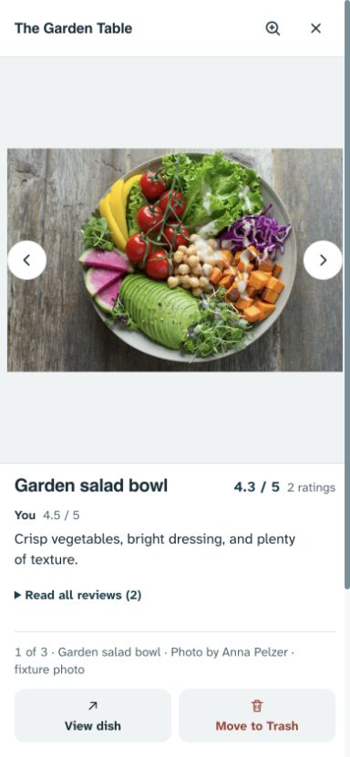
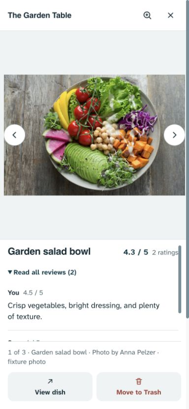
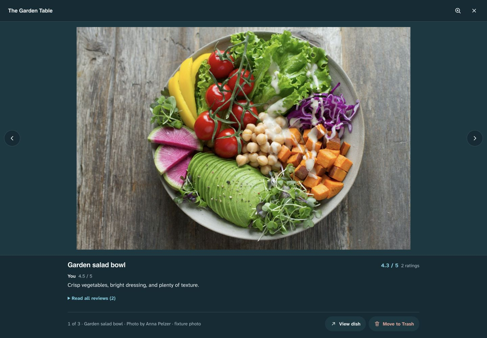
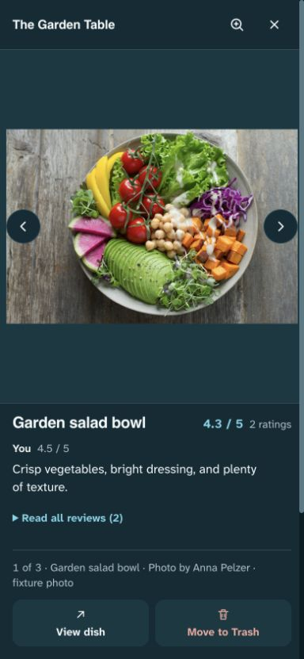

# Photo viewer with dish opinions — 1 November 2026

**Implemented locally; not pushed or deployed.** Dany asked whether dish ratings/reviews could accompany a full-screen photo cleanly, and whether the fixed black viewer could be improved. The current published baseline remains the existing photo-library release; this report does not claim a production rollout.

## Assessment and research

The existing All / Place / Dishes library already preserves a reliable photo-to-dish identity. The full-screen viewer retains that identity but exposes only a View dish exit, forcing a round trip to read the opinion. Its fixed near-black background also detaches it from the app's visual language. Adding a compact, read-only information area below the image is feasible without adding a second modal or a new write path.

- [NN/g: Progressive disclosure](https://www.nngroup.com/articles/progressive-disclosure/) supports presenting useful context first and deferring longer detail. Applied as a rating plus one named preview, with full reviews available on demand. It does not establish a universal preference for this aesthetic.
- [W3C modal-dialog pattern](https://www.w3.org/WAI/ARIA/apg/patterns/dialog-modal/) informs focus containment, Escape and return focus. The native modal and existing library handoffs remain.
- [W3C carousel pattern](https://www.w3.org/WAI/ARIA/apg/patterns/carousel/) supports explicit previous/next controls and user-controlled changes. The current controls stay available; there is no automatic paging. Reading keys inside the review region retain native behavior.

Apple Photos information guidance and Squarespace lightbox documentation were also investigated; the former was rate-limited and neither supplies evidence that this particular layout is universally superior. The chosen composition follows this journal's existing type/palette, Dany's request and local visual checks.

## Decision

Use a smooth canvas that follows the active theme: quiet light surfaces in light mode, layered teal surfaces in dark. Separate header, image stage and reading/actions area through surface levels and hairlines. Avoid blurred photo backgrounds, grain on the image, recoloring, invented scenery or decorative motion. Originals remain complete with contain fitting.

For a rated dish, show beneath the photo:

1. Dish name and average/count of active ratings.
2. One clearly named reviewer with their individual score and a two-line preview. The existing current-user-first ordering is retained; the first written opinion is preferred for the preview. Photo authorship is never inferred to be review authorship.
3. A native Read full review / Read all reviews disclosure when written or multiple opinions exist. Full text and all active individual ratings remain readable and selectable. A single score-only opinion needs no empty disclosure.

The review region is bounded and scrollable, with keyboard focus, so opening a long review keeps photo actions available. It receives no image gesture handlers; scrolling/reading arrows do not swipe or dismiss the image. The photo still receives normal swipe, dismiss, pinch, double-tap, wheel, button and keyboard zoom behavior. A short landscape layout retains usable image space and a smaller scrolling reader.

Place photos and unrated dishes reserve no review area. Context is recomputed for each active photo, cleared on close and updated after removal. Disclosure and reader position reset on photo changes. Data comes from the current loaded dish state; no new network request, schema, identity mapping, moderation or editing interface is introduced. Existing main-photo/Trash permissions, busy/error states, conversion safeguards, gallery selection and focus return remain.

This supersedes only the same-day always-dark presentation rule. The photo library's management and data contracts remain authoritative. The browser chooses image fitting; padding reduces the displayed image area slightly in exchange for a deliberate viewing frame. Reviews consume a bounded portion of the viewer and may require scrolling to read fully.

## Validation

- `npm run check`: **156 tests passed**, syntax checks passed. Build passed.
- Initial existing gallery/capture/photo-layout suite: **58 passed, 4 intentional skips**.
- New unit coverage checks safe text rendering (markup-like names/prose stay literal), clearing context/disclosures between photos, score-only opinions and the surviving photo after removal.
- Browser coverage checks All → Dishes → full viewer and direct-dish entry, exact average/count, excluded deleted reviews, photo credit versus review author, multiple and long opinions, unrated/place transitions, zoom/disclosure reset, focus return, action visibility and native review-reading keys. Contrast/name/ARIA checks run in both themes; 320px phone, short landscape, intermediate and desktop widths are covered.
- An initial mixed-photo assertion incorrectly expected Set as main after navigating onto the existing main photo; it now expects the existing Main photo state. A concurrent test server shutdown caused connection-refused failures in an intermediate focused run; final validation runs on one uninterrupted server. Neither was a product defect.
- Final uninterrupted full Playwright suite after the reader-size correction: **429 passed, 27 intentional skips** across desktop/mobile Chromium (2.4 minutes).
- Bounded visual inspection covered phone/desktop, light/dark and expanded reviews. It prompted one correction: bound the review reader so its content cannot push photo actions out of view. Final confirmation showed the expanded reader scrolling separately with actions still visible. The layout detector returned `[]` before implementation and in the final scan.

Fixtures are disposable, remote responses mocked or blocked. Preview imagery is the repository's licensed Anna Pelzer fixture with fabricated records/reviews. No production record or account setting changed. Physical iOS/Android and comprehensive screen-reader testing remain unverified; automated accessibility checks do not establish universal compliance. Existing zoom-lock policy is unchanged.

## Captures

The local preview uses loopback port 4177. It is a review aid, not a deployment.
