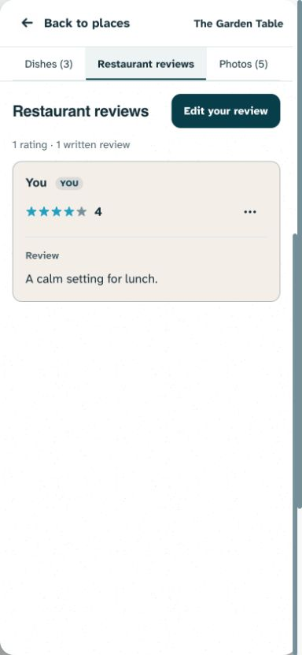
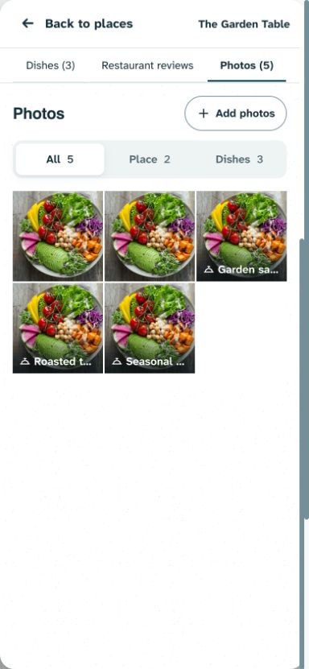
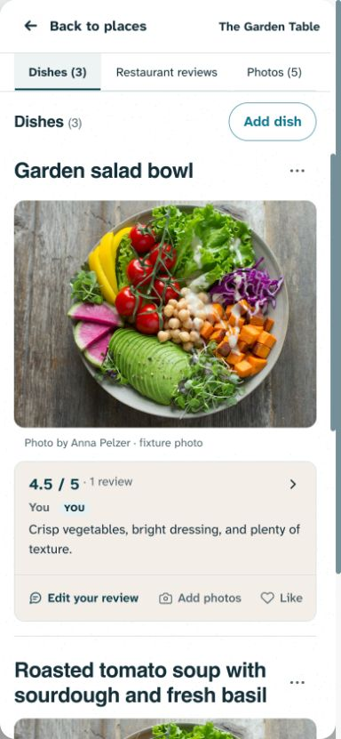
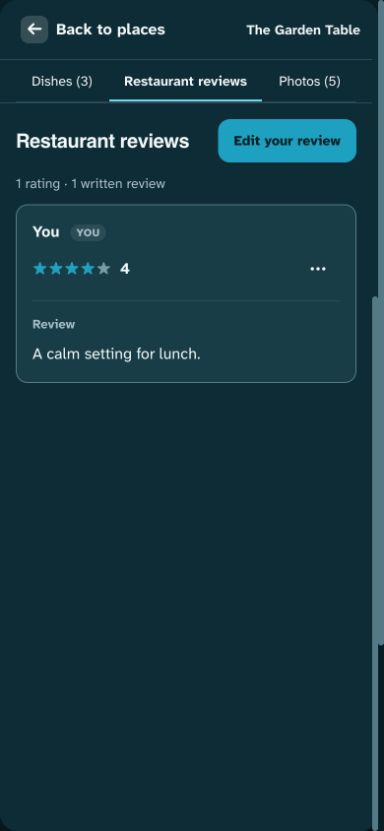
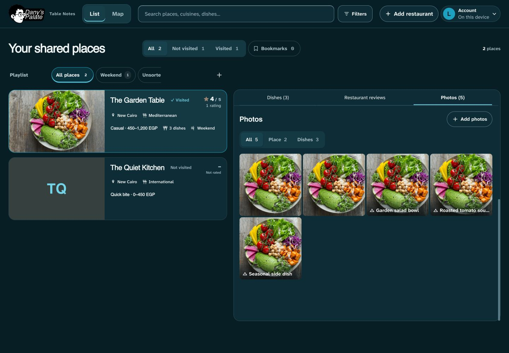
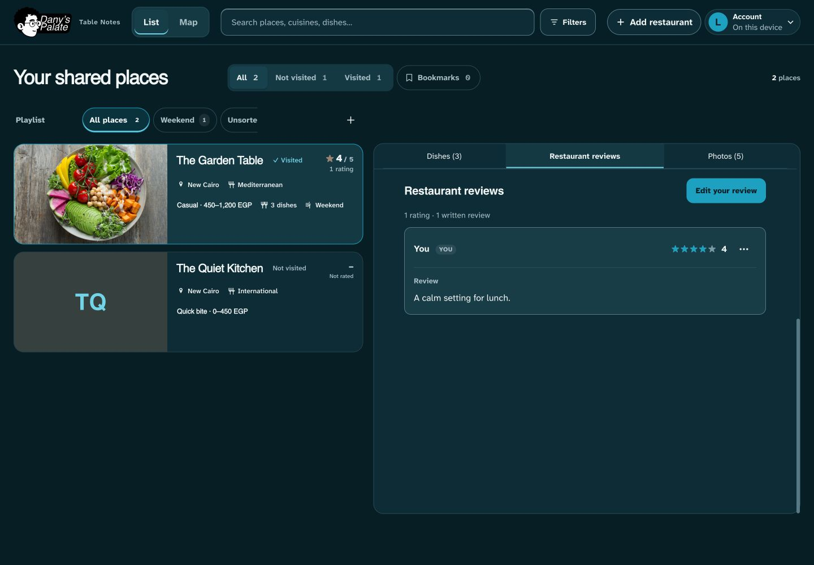

# Unified restaurant views — 1 November 2026

Status: validated and pushed as `999c36b` to `origin/design3.0` at Dany’s request. Post-push health was healthy but still served `cd35ae1`; deployment is not yet verified. Supersedes the earlier Reviews sheet (`c85ecac`) at Dany’s explicit request. No production data, schema, permissions or settings changed.

## Scroll follow-up — publication requested, 1 November 2026

Dany requested stationary tab switching. Tab clicks and keyboard selection now preserve the current restaurant scroll rather than restoring the destination’s previous offset. Short panels retain enough height to prevent upward clamping. The hero photo-count shortcut and header score retain destination scrolling/focus. The shared transition and photo filter remain. Validation: syntax/build and 158 unit tests passed; focused desktop/mobile browser checks passed 42 cases with two intentional skips, including deeper scroll, short panels and hero shortcut behavior. Physical Safari remains unverified. This supersedes the per-view restoration behavior described in the original implementation below. Dany requested publication; live status requires verification.

## Audit and decision

The live public restaurant page was inspected before changing code. Three steps exposed the mismatch:

1. **Dishes — clear content, misleading grouping.** Its selected reading indicator made the whole row look like section navigation, but its neighbors did not follow the same model.
2. **Restaurant reviews — inconsistent navigation.** Activating the neighboring control opened a blocking reader with a backdrop, focus containment and a separate closing gesture. Moving reviews away from dishes reduced clutter, but the popup did not match its position in the navigation bar.
3. **Photos — extra work.** Activating Photos scrolled to a six-tile preview. Reaching the complete filtered library required a second See all action and another dialog.

The problem was interaction consistency, not the number of buttons. Dany’s proposed direction is appropriate here: each label names peer content for the same restaurant, so all three now select local content beneath one pinned bar. Reviews remain separate from Dishes without interrupting browsing. Photos immediately shows the complete library. No extra route, nested Back stack or new menu is needed.

This follows the [W3C tabs pattern](https://www.w3.org/WAI/ARIA/apg/patterns/tabs/): a selected tab exposes its associated panel, with the other panels hidden. Automatic arrow-key activation fits these panels because the records are already loaded locally. This guidance supports semantics and keyboard behavior; the choice to use tabs instead of a dialog is the design judgment from this audit.

## Implemented behavior

- Dishes / Restaurant reviews / Photos are one `tablist`, with one selected `tab` and one visible `tabpanel`. Arrow keys wrap; Home/End select the first/last tab. Only the selected tab is in the normal tab sequence; the active panel is keyboard reachable.
- Header score and hero photo count select the same Reviews/Photos panels. Photos includes All / Place / Dishes filters, existing counts, dish grouping, attribution and Add photos, including empty states. The six-tile preview, redundant See all step and library popup are removed.
- Review rendering retains ordering, full text, timestamps, separate rating/written counts, score-only entries, drafts, own-review actions, moderation and recoverable Trash/Undo. The existing editor remains a native dialog; saving refreshes Reviews and returns focus to its write action. Undo is reachable without closing the non-modal panel.
- Full-screen photos retain the existing viewer, zoom/navigation/dismiss gestures, ratings, review disclosure, management permissions, main-photo selection and photo-to-dish handoffs. View dish and explicit dish search select Dishes.
- The selected view, view-relative reading offsets and photo filter are retained per restaurant for the session. Tab switches do not create browser-history entries. Existing place/filter deep links and Back/Forward behavior remain.
- A shared 160ms opacity/4px ease-out transition gives pointer navigation restrained continuity. Starting another switch cancels the prior animation. Keyboard and reduced-motion switches are immediate. Short panels reserve enough height to keep the pinned bar from jumping downward.
- Keyed reconciliation retains unchanged dish cards and carousels inside the Dishes panel. Embedded library/review events have one owner, avoiding duplicate photo opens when they bubble through the restaurant surface.

## Implementation boundaries

`app.js` owns local tab state, selected-panel application, shortcut entry points and existing renderers. `index.html` changes the old review/library dialog containers into inline sections; existing IDs are retained. `lib/detail-view.js` reconciles the new Dishes wrapper without rebuilding unchanged cards. `styles.css` adapts those existing readers/library to the restaurant surface. No dependency or backend change was needed.

The expanded photo viewer and task dialogs remain separate from browsing navigation. Large restaurant imagery, compact identity, Maps, bookmarks, dish actions and all permission gates remain.

## Validation

- Syntax, production build and all **158 unit tests passed**.
- Full Playwright run: **448 passed, 28 intentional skips**, desktop and mobile Chromium. Tests use disposable fixtures with blocked or mocked remote responses.
- Both-theme tab tests cover selected/hidden panels, no navigation dialog, stable pinned-bar position, keyboard activation, per-view scroll and photo-filter retention, review edit/save/focus, image viewer return, card identity, reduced motion and 320/390/1440px fit. Existing navigation, drafts, moderation/Undo, photo management/conversion, upload recovery and permissions checks also passed.
- After the final header keyboard-motion refinement, a focused four-case follow-up (both themes/projects) passed: header shortcuts focus the selected panel without animation, reduced motion is immediate, and the selected dish photo survives switching and review save. The full suite preceded that isolated refinement; it was not repeated afterward.
- Automated contrast, accessible-name and ARIA checks pass in the relevant views. Impeccable’s scoped layout detector reported no findings.
- The visual loop inspected the initial implementation, corrected short-view bar movement and duplicate event handling, then confirmed phone light/dark and desktop dark layouts with fabricated records and the repository’s licensed Anna Pelzer image. Captures below show the final local design.

Physical iOS/Safari gesture feel and comprehensive screen-reader testing remain unverified. Chromium automation and visual inspection do not establish universal device smoothness. No deployment is implied by these results.

## Visual evidence

