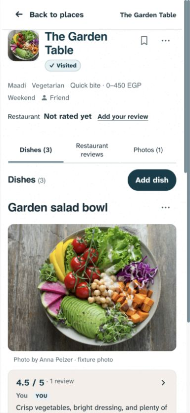
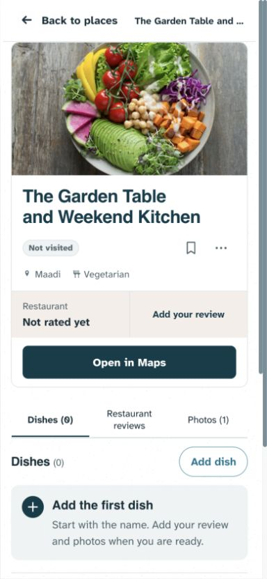
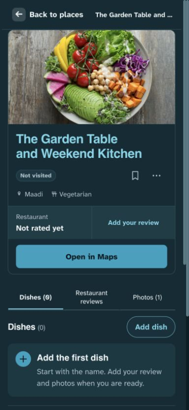
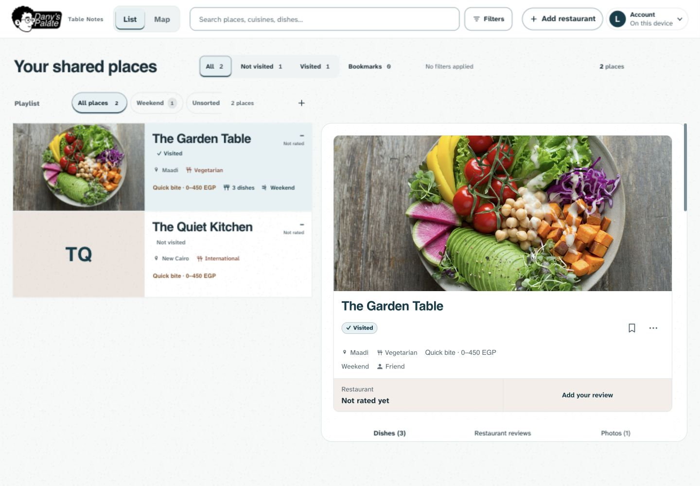
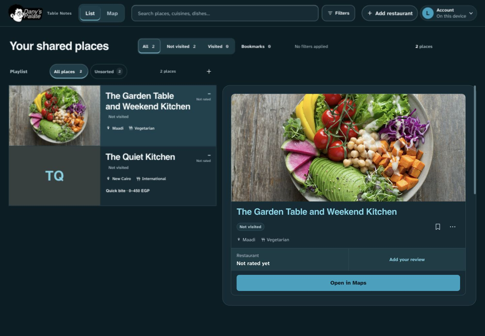
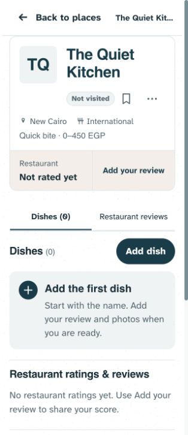

# Restaurant photo and header — 31 October 2026

**Published and verified live: frontend `31128f1`, 31 October 2026, at Dany’s request.** Dany rejected the small restaurant-detail photo and loosely grouped facts in the supplied screenshot. This supersedes the compact header in `431574d`; later documentation-only builds may carry a newer stamp with the same frontend.

## Why the image became small

Commit `9fff4b6` on October 25 replaced the restaurant hero with a 64–72px identity image to expose dishes sooner. That was a deliberate density tradeoff in the [earlier menu implementation](../restaurant-view-audit-2026-10-25/IMPLEMENTATION.md). Later photo-led changes enlarged list and dish photography but retained this small restaurant-header exception. The October 31 dish-action release did not shrink it. Dany's latest feedback supersedes that exception.

## Current decision

A full-width 16:9 restaurant photograph leads the page again, with a 180px minimum and 320px height cap. At the inspected 390px phone viewport it is about 344 × 194px, replacing the previous 64px square. Existing responsive small/full sources let the browser choose an appropriate image instead of forcing the small thumbnail; full originals, main-photo selection and fallback order remain unchanged.

The header is one smooth, bounded surface: photograph, 26px wrapping name, visit/Bookmark/More row, icon-labeled location/cuisine/price, supporting playlists/people, then an attached rating/review area. Related information shares alignment and a boundary rather than floating independently over grain. Maps sits within the same section below the rating area when present. A missing map reserves no empty slot; absent photographs retain compact 64px initials rather than a large empty hero. Back to places stays on one line while long restaurant names truncate only in the sticky rail; the actual heading wraps in full.

This uses the existing palette, type and native controls. The grouping follows the common-region/proximity rationale researched in the [dish-action report](../dish-action-panel-2026-10-31/IMPLEMENTATION.md) and [organized-menu research](../organized-restaurant-menu-2026-10-26/IMPLEMENTATION.md). Photo size is a product preference confirmed by Dany's feedback, not a claim that larger imagery universally improves usability.

**Tradeoff:** the restaurant receives more visual space, so dishes can begin below the first viewport, especially in desktop split views or with long names. Dishes remains the first content section, with its existing jump navigation. No dish-action design, contribution workflow, information, access rule, gallery behavior, main-photo selection or navigation/history/draft contract was removed. Existing DOM reconciliation retains the image and unchanged dish nodes during unrelated updates.

## Validation

- `npm run check`: 143 tests passed, syntax checks passed. Build passed.
- Initial focused browser run: 69 passed, 11 intentional skips; two obsolete assertions required the first dish to appear immediately in the desktop viewport. They now assert that the large restaurant image and name lead, and that jumping to Dishes reveals the dish. No runtime failure was found in that run.
- Full Playwright suite after the header correction and revised assertions: **415 passed, 27 intentional skips** across desktop/mobile Chromium (2.3 minutes). No unresolved failures.
- Photo regressions now assert the restaurant image spans the header, is at least 180px high, uses cover fitting, and exposes responsive full/small candidates. Existing tests cover main-photo updates, originals, Bookmarks, quick metadata edits, access rules, contrast, navigation/scroll retention and native photo/swipe behavior.
- Bounded in-app-browser inspection covered 390 × 844 phone / 1440 × 1000 desktop, light/dark, long names, sparse metadata, Maps present/absent and 320px no-photo layout. The final correction removed inherited surplus name spacing, prevented Back label wrapping and corrected the long-metadata wrap selector. The no-photo header fit within its 280px content width at 320px viewport.
- Impeccable layout scan returned `[]` before and after. This is supporting evidence, not a usability/accessibility certification.

All automated content is disposable with mocked/blocked remote responses. Visual previews use fabricated restaurants and the repository's licensed Anna Pelzer salad fixture; the photograph is illustrative, not a copy of Dany's restaurant. No production data was read into fixtures or changed. Physical iOS/Android and comprehensive screen-reader checks remain unverified.

## Captures

Loopback preview port 4176 is a local review aid, not a published release.

## Publication evidence

Commit `31128f1` was pushed to `origin/design3.0`. Live read-only verification returned `status: ok` / `Design 3.0`, built at `2026-10-31T21:47:37.630Z`. Health, HTML and service-worker stamps matched `31128f1`. Live SHA-256 hashes for `app.js`, `styles.css`, `lib/detail-view.js` and the ceramic tile matched repository source. No bindings, runtime settings, schema or production records changed.
