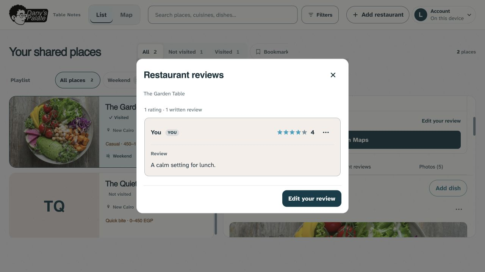
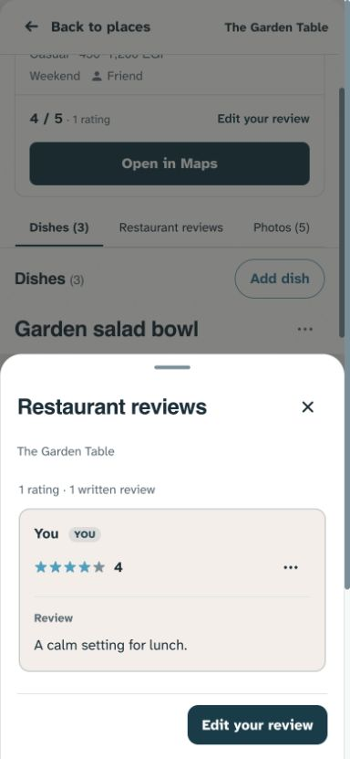
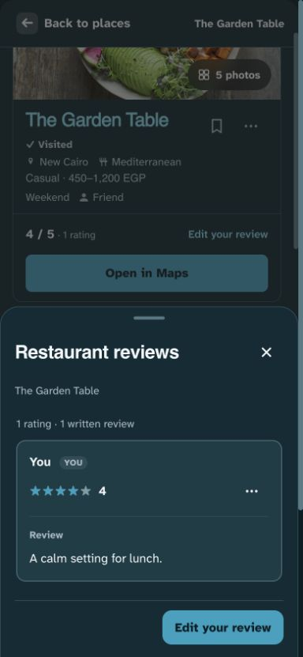

# Separate restaurant reviews — 1 November 2026

Implemented locally, not pushed/deployed. Dany explicitly rejected the inline Restaurant ratings & reviews section as crowded. This supersedes the prior inline section and Reviews scroll destination while retaining the compact header and large photograph.

The header score and Restaurant reviews control now open a native modal reader. Phones use a bottom sheet; desktop uses a centered dialog up to 640px wide. The main page flows from dishes to photos without repeating the full restaurant review list. Reviews is a dialog action, not an active scroll section; Dishes/Photos retain their existing reading indicator.

The reader reuses the existing safe review renderer: current-user-first ordering, separate rating/written counts, complete authored text, timestamps, score-only rows, empty-state guidance and permission-aware own-review/moderation actions. No data paths, identities or schema changed. The existing independent editor opens above the reader. Save refreshes visible content and returns focus to the write action; cancellation retains draft behavior. Own-review Trash closes the reader, keeping the existing Undo toast reachable. Undo retains its newer-version safeguard.

Close, Escape and backdrop return focus to the opener and restore restaurant scroll. Reading position survives live refresh; unchanged markup retains its nodes. Changed content moves focus to the reader rather than a detached row. Switching/removing the current place closes stale reader content. Dish/photo readers and their gestures remain independent. Native modal focus containment prevents background interaction.

## Validation

- Build, syntax and **158 unit tests passed**.
- Final full Playwright: **448 passed, 28 intentional skips**, desktop/mobile Chromium (3.1 minutes).
- New both-theme reader tests check no inline review block, both entry points, count/prose, editing and live refresh after save, write-button focus, 320/390/1440px fit, Close/write visibility and automated contrast/name/ARIA checks.
- Existing regression coverage now enters the reader for drafts/stale edits, own actions/right-click, moderation, Trash/Undo, separate restaurant description, background updates, carousel/node retention and scroll restoration. Obsolete inline-section assertions were replaced with reader assertions. Dishes/Photos still test heading focus and reading tracking.
- Visual inspection covered desktop light and phone light/dark, including the centered desktop dialog and bottom-sheet adaptation. A bounded correction aligned the place name with the title and removed the desktop drag handle. Impeccable layout detector returned `[]`.

Tests use disposable records and mocked/blocked remote responses. Preview uses fabricated records and the repository's licensed Anna Pelzer fixture. No production data/settings changed. Physical Safari/Android and comprehensive screen-reader behavior remain unverified.

