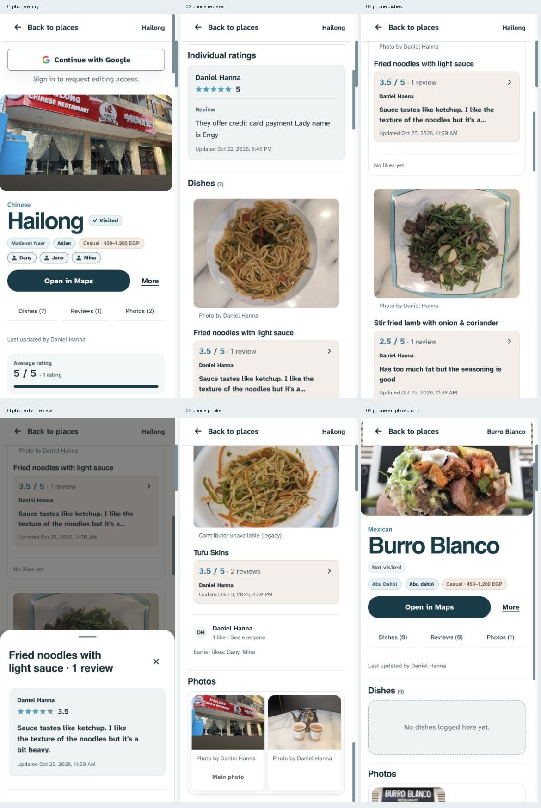
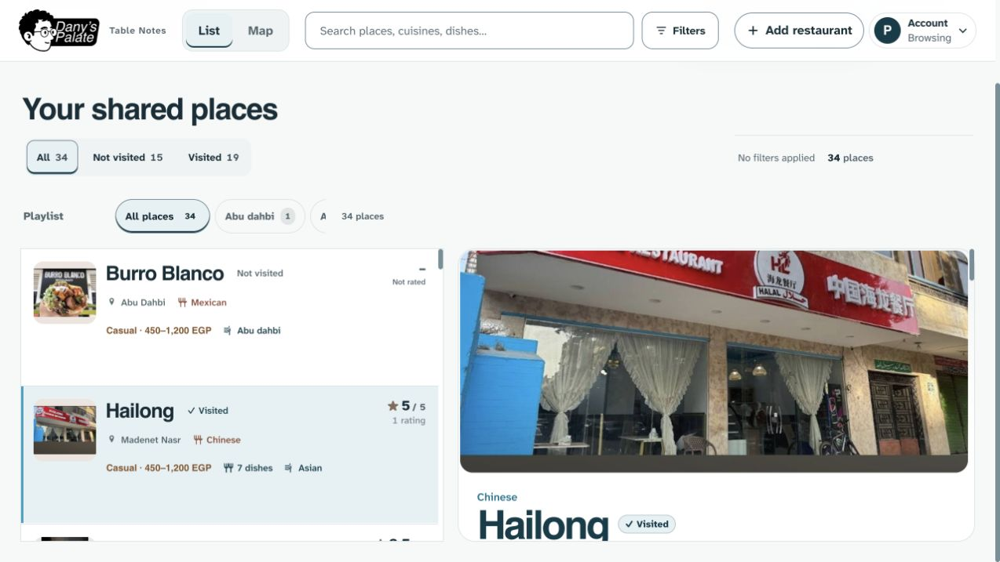

# Restaurant-view UX audit — 25 October 2026

Method: dual-agent (A: `/root/restaurant_design_review`; B: `/root/restaurant_evidence_review`) plus primary-agent live phone walkthrough. Assessment A finished before the parent read Assessment B's findings. Dany explicitly approved both independent reviewers.

**Verdict: the visual identity is good; the information arrangement needs work for a menu-like browsing task.** The largest gains will come from earlier orientation, a compact dish comparison view, consistent section order, and clearly scoped restaurant versus dish ratings. More cosmetic styling will not resolve those problems.

Original audit status: audit and recommendations only. Subsequent implementation is documented separately in [IMPLEMENTATION.md](IMPLEMENTATION.md), following Dany’s explicit dishes-first/compact-comparison selection. No app changes, tests, commits, push, deployment, sign-in, or production writes in this audit. Project memory records one newly observed unresolved navigation risk (RISK-05); proposed layouts are not adopted decisions.

## Scope and product truth

Inspected the running [food.danyhanna.uk](https://food.danyhanna.uk) in new in-app browser tabs, with current source on `design3.0` as context. Phone: 390×844 browser viewport. Desktop: approximately 1280×720. Light theme, signed out. Populated Hailong, sparse Klay, and unrated Burro Blanco expose different content/empty states. Editor controls were inspected in source, not an authenticated live session.

The product is a friends' restaurant journal. “Dishes we've tried” is a more accurate mental model than promising a complete restaurant menu. Keep personal authorship, separate restaurant/dish opinions, photo attribution/originals, likes versus Earlier likes, private Bookmarks, contextual editing, recoverable Trash, and the chosen branding/type. Do not invent dish prices or collapse independent opinions into a score. Preserve history/swipes, per-place saved positions, and unchanged carousels.

## Captured steps

| Step | Flow | Health | Evidence |
|---|---|---|---|
| 1 | Open a populated restaurant | Needs improvement: hero/access content dominates before food | [Phone entry](screenshots/01-phone-entry.png), [desktop entry](screenshots/07-desktop-entry.jpg) |
| 2 | Read the restaurant rating/opinion | Mixed: clear author, but inconsistent scope/labels and repeated summary blocks | [Restaurant reviews](screenshots/02-phone-reviews.png) |
| 3 | Browse and compare dishes | Needs improvement: large serial cards hide names below photos | [Dish cards](screenshots/03-phone-dishes.png) |
| 4 | Open a complete dish review, then close | Good: focused sheet, full prose, clear Close; focus returns to opener | [Full review](screenshots/04-phone-dish-review.png) |
| 5 | Jump to restaurant photos | Mixed: jump works; section choices disappear while reading | [Photos](screenshots/05-phone-photos.png) |
| 6 | Read an unrated/sparse restaurant | Needs improvement: large empty blocks precede useful food on desktop | [Phone sparse state](screenshots/06-phone-empty-sections.png), [desktop empty sections](screenshots/08-desktop-empty-sections.png) |
| 7 | Switch from a scrolled restaurant to a new one | Defect: first-open place can inherit another place's offset | [New-place scroll](screenshots/09-desktop-new-place-scroll.png) |

## What works

- The restrained teal identity, real food photography, and named opinions belong to this particular group journal. Preserve them.
- Maps and More have distinct emphasis. Browsing generally exposes only two actions and two or three section choices; it does not need another generic menu.
- Full dish reviews already use progressive disclosure effectively. Review Close/Escape restores the originating control; the phone Back header retains the place name.

## Five priority changes

### 1. [P2] Put restaurant identity and context within immediate reach

At 390×844, access prompt, hero, title, tags, directions and attribution consume nearly the first screen; the restaurant score reaches the bottom and no dish is visible. On the inspected desktop, a 284px hero occupies most of a roughly 376px detail viewport. A separate reproduced defect makes a newly selected restaurant open at the prior restaurant's offset: Hailong → Dishes → first-open Klay yielded panel `scrollTop=1051` and a title above view. These are separate causes of the same orientation difficulty.

**Fix direction:** compact title/metadata plus a small restaurant photo and explicitly labeled restaurant score/count first; keep Maps, Bookmark, More and sign-in available with less vertical cost. Initialize previously unopened places at the top, while retaining saved positions for actual returns and explicit matching-dish search targets. The scroll defect's source is `createDetailViewStore.restore()` returning without resetting a view that has no saved state. See `lib/detail-view.js:98`, `app.js:5289` and `app.js:5455`.

Suggested next command: `$impeccable layout`; the scroll defect also needs a focused regression fix.

### 2. [P2] Make dishes easy to compare before opening full detail

A mobile dish can occupy roughly 550px with image, attribution, title, review preview, timestamp and empty likes. Names appear below large photos. Seven dishes require serial scrolling rather than a quick choice. This is an observed comparison cost, not proof of abandonment or a measured task-time increase.

**Fix direction:** compact dish name, thumbnail, dish rating/count and one short named opinion preview. Opening the dish reveals the full photo carousel and authored reviews through clear existing controls. Retain review/photo contribution shortcuts, likes, details and More in the dish context. Keep Earlier likes distinct. Hide empty guest “No likes yet” filler in the initial scan; keep actual like information.

Suggested next command: `$impeccable shape`.

### 3. [P2] Give ratings/reviews clear scope and use one predictable reading order

Hailong's “Reviews (1)” means one restaurant rating, while its dishes have their own review counts. Klay has “Reviews (0)” even though a dish has a review. Counts are correctly calculated for separate collections; their scope is unclear. “Reviews” lands at “Individual ratings”, and score-only entries are counted as reviews. The current restaurant aggregate is also a separate large block before the individual list.

Desktop order is ratings → photos → dishes. Phone order depends on whether the restaurant has ratings: rated places keep ratings first; unrated places move dishes/photos before empty ratings. This is intentional current behavior, not a random render bug; the view is held stable during the visit. A consistent new order would require explicitly superseding that presentation rule in DESIGN.md while preserving stability during updates.

**Fix direction:** show **Restaurant rating · N ratings** beside the title. Use a clearly named restaurant ratings/reviews section; distinguish numeric ratings from written opinions in its count/copy. Dish scores remain labeled and attached to their dishes. Adopt one predictable food-first content order for the proposed menu-like task. Do not combine restaurant and dish totals.

Suggested next command: `$impeccable clarify` with `$impeccable layout`.

### 4. [P2] Keep a small section navigator available while reading

Dishes/Reviews/Photos work at entry, then scroll away. Only Back remains on phone, and the section controls do not indicate the current section. The navigation order also differs from desktop content order. Reaching another section later requires returning up a long page.

**Fix direction:** a small page-local sticky strip for Dishes, Restaurant reviews, Photos, with current-section indication and headings clear of the sticky region. Do not add more top-level choices or make it look like global site navigation. Its labels, order and destination headings should match. Keep native page reading rather than introducing nested sub-tabs.

Minor semantic issue: Reviews focuses its H3; Dishes and Photos focus generic wrapping DIVs. Target the real headings consistently. This is a confirmed focus-target difference; screen-reader impact was not tested.

Suggested next command: `$impeccable adapt`.

### 5. [P2] Shrink empty and repeated information

Klay's empty restaurant ratings and empty photos each measured 240px high against a 376px detail pane. Two empty blocks consume 480px before headings/gaps, preceding an existing dish. Other repetition includes average rating, its bar, Individual ratings, an additional Review label, and a timestamp block.

**Fix direction:** one short empty message per section with the relevant permitted contribution action. Preserve every empty contribution path. Keep author, score and meaningful review prose prominent; make timestamps/administrative update attribution quiet. Replace the large aggregate tile with the compact header summary rather than adding another summary beside it.

Suggested next command: `$impeccable distill`.

No P0/P1 failure was established by this browsing-only audit. This does not grade untested save/auth/error paths as safe or correct.

## Recommended content structure

1. Phone Back and restaurant name.
2. Compact identity: title, small photo, cuisine/location/budget/visit state, Bookmark, restaurant score and rating count.
3. Maps and quiet More; compact account access for guests, contextual own-review shortcut for editors.
4. Page-local Dishes / Restaurant reviews / Photos navigation.
5. Dishes we've tried: compact comparison list, then contextual full detail.
6. Friends' restaurant ratings and written opinions; all authors and score-only entries retained.
7. Restaurant photos and contribution.
8. Supporting shared description and update details; a short useful description may preview near the header and expand on request.

Use the same content order on desktop and phone, adapted to the available space. This is a proposal, not an implemented or user-approved replacement for current ordering. Keep price as approximate EGP per person; no dish-price data exists in this design brief.

## Research and Hick's Law

- [Hick's Law — Laws of UX](https://lawsofux.com/hicks-law/): reduce competing choices and make the recommended path evident. Here the observed guest controls are already few; improve sequence and dish comparison before hiding more actions. There is no scientific rule that a restaurant screen must have exactly one clickable button or at most four choices.
- [Progressive disclosure — Nielsen Norman Group](https://www.nngroup.com/articles/progressive-disclosure/): keep frequently needed information visible and defer specialized detail behind clear labels. A dish's name, image, score and review count belong in the first scan; full images, full prose and management can reveal contextually.
- [Recognition and recall — Nielsen Norman Group](https://www.nngroup.com/articles/recognition-and-recall/): reduce memory demands by keeping options/context visible. Compact comparison rows and a current-section marker support that goal.
- [Ratings and counts — Baymard](https://baymard.com/research-articles/user-perception-of-product-ratings): users need the number of ratings to interpret an average. Apply this cautiously: the study concerns ecommerce lists, not this small friends' journal. Preserve count beside score, with its restaurant/dish scope explicit.
- [Rating distributions — Baymard](https://baymard.com/research-articles/user-ratings-distribution-summary): summaries can orient review reading in large review sets. This does not justify adding a distribution dashboard for a restaurant with one or two friends' ratings; a compact score/count and named opinions suit the present product better.
- [In-page links — Nielsen Norman Group](https://www.nngroup.com/articles/in-page-links/): section links help long pages when labels match destinations, headings stay visible, and users can tell where they are. This supports a clearly page-local navigator, not another global navigation layer.

The proposed menu-first layout is an informed design hypothesis. No usability study or analytics in this audit proves it is universally best.

## Heuristic assessment

Expert browsing assessment, not a benchmark or a measured satisfaction percentage. Two untested heuristics are excluded from the denominator.

| # | Heuristic | Score /4 | Main evidence |
|---|---|---:|---|
| 1 | Visibility of system status | 3 | Counts/visit state present; current section unclear |
| 2 | Match with real-world tasks | 2 | Menu reading order and review scope require interpretation |
| 3 | User control and freedom | 3 | Back, Close, Escape and review focus return |
| 4 | Consistency and standards | 3 | Cohesive styling; order/terminology varies |
| 5 | Error prevention | n/a | No live submission or destructive task tested |
| 6 | Recognition rather than recall | 2 | Long dish comparisons and disappearing navigation |
| 7 | Flexibility and efficiency | 3 | Working jumps; avoidable long scrolling |
| 8 | Aesthetic/minimalist design | 2 | Good restraint, excessive hero/empty/summary space |
| 9 | Error recovery | n/a | Failure/recovery paths not induced |
| 10 | Help and explanation | 2 | Useful access guidance, ambiguous rating/review terminology |
| | **Total** | **20/32** | Directional expert score; no earlier comparable critique run |

## Cognitive and emotional journey

Moderate observed load: three of the eight checklist items need work—single task focus, visual hierarchy and working memory during dish comparison. Grouping, focused detail sheets, limited guest peer choices and basic progressive disclosure are strengths. Do not turn the skill's four-item heuristic into a universal choice limit.

- Distracted diner: the delay before reaching dishes is the main friction point. Photos and named opinions then provide useful reassurance.
- First-time visitor: “Reviews (0)” beside a reviewed dish invites a mistaken interpretation. Labeling the scope is more useful than removing content.
- Returning visitor: saved own-place positions help, but a first-open place inheriting another place's scroll loses orientation. Those behaviors must be distinguished when fixing it.

Editor action density is only a hypothesis from source: the card has review/photo/edit/like/More paths, but these are contextual rather than seven peer primary choices. Current decisions require those contribution shortcuts to remain visible.

## Detector and accessibility evidence

Assessment B ran the static detector once on index.html. It returned 31 advisories, all at line 0: thin-border/wide-shadow 21, radius 6, color 3, repeating-stripes gradient 1. No confirmed restaurant-detail true positive could be assigned: this HTML has an empty detail shell rendered from JavaScript. Most snippets concern other controls or lack usable element locations. The stripe advisory was a false positive for the inspected surface: runtime body pattern was none. These advisories are not 31 proven restaurant UX defects.

Sampled section controls were 44px high; More was 64×48px. One empty-state text contrast sample measured 5.32:1. No small-target or contrast failure was established for those samples. Heading-focus inconsistency remains a concrete semantic concern; complete keyboard/screen-reader and dark-theme checks were outside this audit.

## Follow-up choices

1. Content priority: **Dishes first (recommended)** / Restaurant reviews first / Keep current order.
2. Next scope: **Restaurant layout plus compact dish comparison (recommended)** / Header and navigation only / Audit only.

These preferences guide any later implementation; none of the proposed layout changes is implemented by this report.
