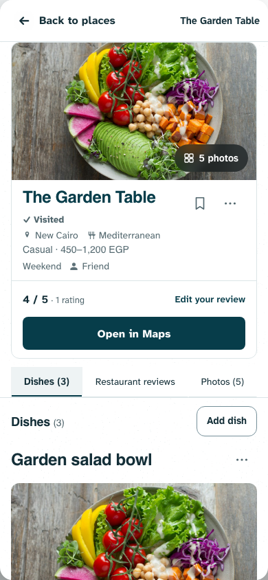
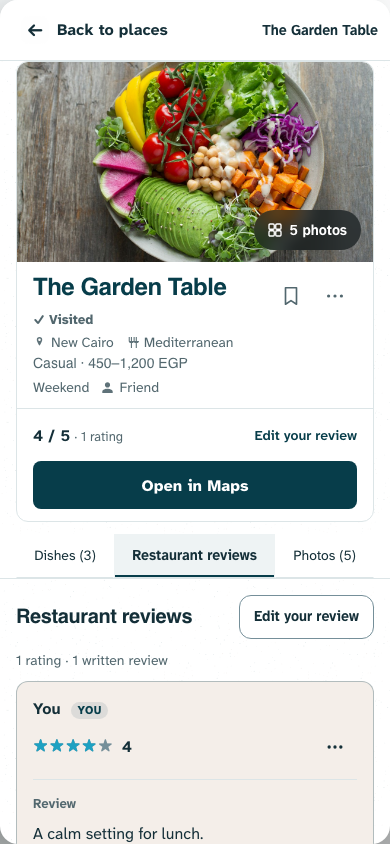
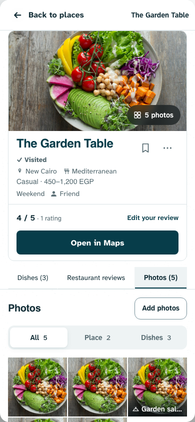
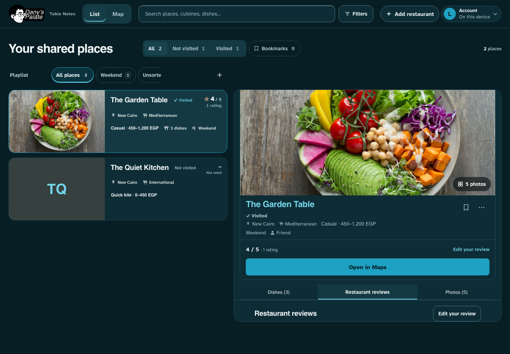

# Consistent restaurant section actions — 2026-11-01

Status: pushed `5ba3910` to `origin/design3.0` at Dany’s request; live rollout unverified. The release health checked during publication was healthy and served the previous `d2dddef`. Dany approved matching Add dish, Add/Edit your review and Add photos after noticing inconsistent emphasis across the three tabs.

The three peer actions now share `place-section-action`: outlined, content-width, 44px minimum height, 12px corners, 14px bold labels and 14px horizontal padding. They use matching theme-aware border, background, text and interaction states. All three use text without decorative icons. This replaces the conditional primary Add dish, filled review action and photo-only plus icon. Maps and form Save retain their existing roles. The native photo input remains keyboard reachable and its focus ring appears around the complete control.

Only presentation and the native input’s visibility technique changed. Contribution forms, upload handlers, authorship, permissions, drafts, scroll policy and hero photo shortcut remain.

## Validation

- Syntax and all 158 unit tests passed; build passed.
- Relevant layout/library/hierarchy browser checks: 48 passed, 2 intentional skips across desktop/mobile Chromium, both themes. One hierarchy assertion was updated because a no-Maps place no longer promotes Add dish to a filled primary action.
- Final local fixture inspection confirmed all three buttons have identical computed height, corner radius, typography, padding, border/background/text styling within each theme. Final native input accepts keyboard focus. Visual inspection covered the three phone light views and desktop dark; captures use fabricated records and the repository’s licensed Anna Pelzer image.
- No production data writes; deployment is not yet verified. Physical Safari remains unverified. Browser suite preceded the final native input focus styling; final focus/computed-style and visual checks used the final build.

