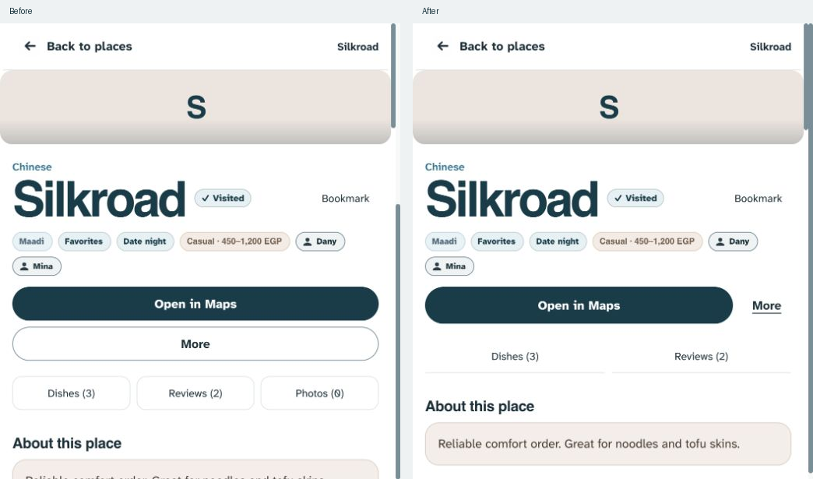
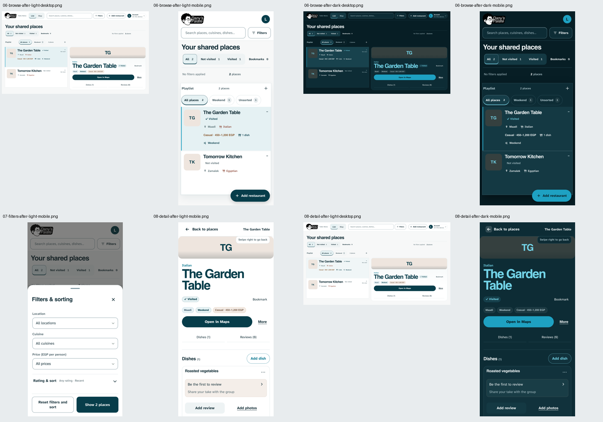

# FoodLog UX audit and improvements — 25 October 2026

Status: implemented locally on `design3.0`, branched from `design2.0`. Not pushed or deployed. No production data, schema, access, or storage changes.

## Scope and evidence

Goal: help friends find a restaurant, understand its memories, and contribute without having to interpret competing controls. Dany requested a clean, consistent interface guided by Hick’s Law.

The audit captured the running local app in the in-app browser before implementation. The numbered before captures show the repository’s built-in seed collection, with no production connection. Automated after captures use disposable invented records and block external requests. The native detail comparison uses the same seed restaurant and viewport. Different fixture/viewport captures illustrate coverage, not measured task-speed gains.

Constraints checked against `thought_Process.md`, `PRODUCT.md`, `DESIGN.md`, code, and regression tests: preserve the supplied branding, Helvetica/Atkinson roles, square rows, whole-photo fitting, contextual contributions, restored restaurant form, approval boundaries, Bookmarks, all filters, drafts, gallery, history/swipes, and recoverable Trash. No new skill installation was needed; Impeccable’s distillation guidance and Product Design’s screenshot audit were sufficient.

## Research applied

- [Hick’s Law — Laws of UX](https://lawsofux.com/hicks-law/): choice complexity can slow decisions. Apply this as a hierarchy guide, not a demand to hide useful content or remove capabilities.
- [Progressive disclosure — Nielsen Norman Group](https://www.nngroup.com/articles/progressive-disclosure/): show common choices first; clearly label the path to specialized choices. Location/cuisine/price stay visible; Rating & sort is one expansion away. This grouping is a design hypothesis, not established usage frequency.
- [Button — GOV.UK Design System](https://design-system.service.gov.uk/components/button/): avoid competing main actions and name buttons by what they do. Keep Save prominent; make global creation secondary alongside restaurant detail.
- [Button states — Nielsen Norman Group](https://www.nngroup.com/articles/button-states-communicate-interaction/): distinguish action emphasis from selected/pressed state. Quiet selected chips retain their explicit state and boundary.
- [WCAG 2.2 — W3C](https://www.w3.org/TR/WCAG22/): check labels, focus, contrast, and usable targets alongside visual simplification. The project keeps its stronger 44px touch-target standard. Its intentional page zoom restriction remains an existing accessibility limitation requiring Dany’s decision to change.

## Captured flow and findings

1. **Browse restaurants — improved.** [Before](screenshots/01-browse-before.png). Saturated selected filters and playlists resembled task buttons; repeated outlined metadata competed with names. The stacked heading, summary, and rail consumed phone space. Selected chips/navigation now use a pale selection surface and inset indicator. List metadata is unboxed and spacing is tighter, while row minimums, counts, and reserved update/filter slots remain. Phone Add remains the primary creation action; desktop Add is secondary beside the selected restaurant.
2. **Filter and sort — improved.** [Before](screenshots/02-filters-before.png). All five selectors appeared at once. Location/cuisine/price now lead; a native Rating & sort disclosure shows the current choices in its summary and opens on entry for non-default settings. Live results, reset semantics, URL/state compatibility, and the Show N places footer remain. Keyboard Enter can expand it.
3. **Restaurant details and dish contributions — improved.** [Before](screenshots/03-detail-before.png). A full-width More button rivaled directions and displaced content; Photos (0) led to empty content. Maps now sits beside a quiet More action. Without Maps, Add dish receives primary emphasis. The empty Photos jump is omitted while the photo section and contribution remain available. Review and photo shortcuts remain visible, using tonal-secondary and underlined-text roles respectively. Photo upload is secondary; section navigation uses quiet underlined tracks.
4. **Add restaurant — healthy, retained.** [Capture](screenshots/04-capture-before.png). Name is emphasized, only name is required, Save stays visible, Maps is optional, and More details holds secondary information. Changing this form would reintroduce a previously rejected layout; preserve it. Existing capture/draft/validation tests remain the evidence for behavior beyond the first viewport.
5. **Account/settings — healthy local state, limited visual coverage.** [Capture](screenshots/05-settings-before.png). Account contains Settings, Refresh, theme, and Trash rather than crowding the browse screen. Local Settings shows a simple expandable sync status. No changes needed. Owner management and signed-in production states were not visually audited in a live account; mocked regression tests cover their existing behavior.

## Before and after

Same native viewport and restaurant:

Desktop/phone, light/dark verification:

The screenshot files are saved beside this report. The automated captures cover browse, filter, and detail for both themes on desktop Chromium and Pixel 7 emulation.

## Action roles

| Surface | Main task / prominent action | Secondary access |
|---|---|---|
| Phone restaurant list | Find/open a restaurant; one solid Add restaurant entry for editors | Quiet filters, playlist selection, account menu |
| Desktop browse/detail | Read selected place; Open in Maps, or Add dish without Maps | Header Add restaurant, contextual More, Bookmark |
| Filters | Show N places | Reset; Rating & sort disclosure |
| Restaurant/dish/review form | Save the current contribution | More details; secondary repeat entry where supported |
| Dish card | Review contribution has stronger local emphasis | Underlined Add photos; quiet details and More |
| Settings | Understand sync/account state | Existing permission-dependent account/admin tools |

Selected filters are choices, not competing calls to action. Reading/browsing screens do not need an invented submit button to satisfy the hierarchy rule.

## Verification and limits

- `npm run check`: passed JavaScript syntax checks and all 142 unit tests.
- Full `playwright test --workers=4`: 395 passed, 25 existing platform-specific skips; no failures. Includes local/mocked saves, draft recovery, permissions, likes, playlists/Trash, history/swipes, reload stability, forms, gallery and maps.
- After the final dark metadata border/background correction, the affected hierarchy and visual-rhythm suites passed again: 10/10 desktop/phone light/dark tests. These check contrast, labels, keyboard disclosure, filter reset/reopen, action availability, and overflow.
- `npm run build` and `git diff --check`: passed. Local documentation links checked with no missing targets.
- Saved screenshots inspected together for desktop/phone and both themes; native before/after detail inspected at matching dimensions. Historical screenshot artifacts overwritten by existing tests were restored; new evidence stays in this report’s folder.

Remaining uncertainty: no observed usability sessions or analytics establish that rating/sort are less frequently used than the three visible filters. Check this grouping with Dany and friends during normal use. Automated contrast/label checks and keyboard interactions do not establish complete accessibility compliance. Physical iOS/Safari, assistive technology, real device keyboards, and production network failures remain outside this local validation. Live auth/production write paths were not exercised. Existing zoom-lock, playlist concurrency, and review-concurrency risks remain as documented in project memory.
