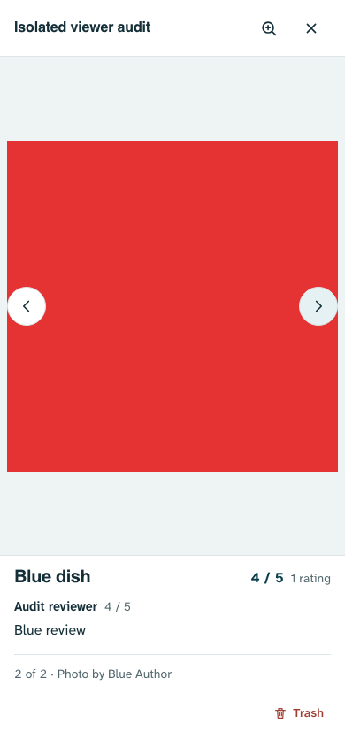

# Loading, rendering and navigation audit — 2 November 2026

Audited source: `0bb8057` on `design3.0`. Status: read-only application audit. No runtime source, production records, permissions, schema, deployment or dependencies changed. Diagnostic scripts and fabricated evidence are kept in this directory. Project memory records the unresolved risks.

**Implementation follow-up:** Dany authorized the fixes after this read-only audit. [Local implementation and validation](IMPLEMENTATION.md) supersede the unresolved status below; the baseline findings/evidence remain historical.

## Verdict

The current architecture is worth keeping. Vanilla JavaScript, keyed reconciliation, cached startup, held browse ordering and guarded gestures already address many common causes of movement. The highest-value work is correcting state ownership and asynchronous presentation, rather than adding motion or replacing the frontend stack.

Six concrete weaknesses were reproduced. The newer tabs do not fully preserve the earlier scroll/focus guarantees, and the viewer can display an image with information/actions belonging to another image during a slow download. These should be corrected before cosmetic animation work.

## Findings, ordered by practical priority

| # | Severity / category | Location at audited commit | Finding and direct evidence | Fix direction / boundaries |
|---|---|---|---|---|
| 1 | HIGH — correctness / loading | `lib/photo-gallery.js:319–351` | Next sets the new source, caption, dish review and management target before the original finishes loading. In Chromium, the previous red bitmap remained visible after 300ms while the caption/review said Blue and the blue request was held. Trash was enabled; its **mock, in-memory callback** received `blue`, the unseen photo. | Make presentation atomic: a cancellable photo generation owns load/decode, image, metadata and commands. Either keep the old complete state until ready or show an explicit pending image state with management disabled. Preserve full-quality originals, permissions, recoverable Trash, navigation and review disclosure. Reject stale success/error callbacks after another selection or close. |
| 2 | HIGH — unintended scroll movement | `app.js:9342–9356`, `9365–9376`, `5467–5471`; `lib/detail-view.js:50–94` | Tab clicks pad a short panel to preserve current scroll, but `applyDetailSection()` resets that padding during refresh and resize. In phone fixture, an unchanged-content timestamp update moved Reviews from **1100px to 465px**; desktop **1100px to 584px**. An 80px viewport-height change caused the same upward clamp after its resize event. | Retain the active view’s required scroll extent through background render/resize, restore after final panel geometry, and anchor reviews/photo content as well as dishes. Preserve stationary tab switching and the hero photo shortcut’s destination scrolling. Do not solve this by always scrolling tabs to the top. |
| 3 | HIGH — cold loading dependency | `app.js:3305–3319` | Ready restaurants wait for optional dish Likes. Primary fixture data was ready at 97.7ms; holding Likes for 700ms still showed **0 places /4 skeletons**. Releasing Likes displayed 2 places. The current code permits a 5000ms timeout before its fallback. This is a controlled dependency reproduction, not a real-network speed benchmark. | Paint primary collection/cache without waiting for Likes, then merge Likes into the correct account/request generation. Preserve fresh data, known previous likes, ordering, approval rules, targeted refresh scope and late-response cancellation. Do not weaken the deliberate real-access gate. |
| 4 | MEDIUM — focus retention | `app.js:5325–5331`, `5462–5463`, `5472–5480` | Each detail render appends the existing embedded library/reviews section again, detaching focused descendants. Focus identity omits the library key, so fallback selects the first matching action. Both phone/desktop fixtures moved focus from `dish:A-dish-3:A-3-photo-2` to `dish:A-dish-0:A-0-photo-2` after a timestamp refresh. | Only attach containers when their parent changes; preserve focus on connected nodes. Include library/review identities in fallback restoration, and use a nearby safe fallback only if the original item disappears. Keep focus restoration without automatic scrolling. |
| 5 | MEDIUM — stale render invalidation | `lib/render-list.js:3–24`; `app.js:10186–10192`; `lib/photo-gallery.js:6` | Set as main saves the new dish cover but the detail fingerprint does not include `coverPhotoId`, so the card need not repaint. Real local UI probe saved `two` while the card’s first image stayed `one`; the pure fingerprint comparison is also unchanged. | Include the cover identity in detail invalidation and verify changed-photo order without rebuilding unrelated cards or losing carousel/reading context. Keep legacy cover behavior and existing data/permission paths. |
| 6 | MEDIUM — animation lifecycle | `lib/photo-gallery.js:350–351`, cleanup `277–285`, close `410` | Paging starts an image WAAPI animation without retaining/cancelling it. A synchronous Next → Close → reopen probe found the old **running 220ms translate/opacity animation** still attached to the newly opened image. This confirms ownership leakage; it does not quantify perceived dropped frames. | Own/cancel paging motion on replacement, close, remount and direct manipulation; ensure old motion cannot affect a new photo/session. Preserve the authored 220ms ease-out for ordinary pointer paging and current reduced-motion behavior. |

## What should remain deliberate

- Cached places stay visible while cloud refreshes; do not replace them with a fresh loading screen.
- Real approval controls editing. Startup deliberately waits for actual session/access results; cached approval is not a permission grant.
- Browse order stays put on background updates; Update order/manual Refresh/deliberate filters accept new sorting.
- Back/Forward intent cancellation, the 180ms drawer, live parallax underlay and recent-velocity gesture decisions are intentional. Root View Transitions must not compete with phone drawer gestures.
- Direct gestures remain usable under reduced motion; decorative travel resolves immediately.
- Page zoom locking is Dany’s explicit choice. Gallery pinch/keyboard zoom and complete original images remain.
- Stationary tab switching may require retained blank extent when the destination is short. That tradeoff follows Dany’s explicit request; the defect is losing that extent later, not its presence.
- Large photo crops, dish cards, safe areas, compact controls, deferred rendering during drawer/carousel gestures, own-review drafts and recoverable Trash/Undo stay intact.

## Coverage and evidence

- Existing startup regression suite: **12 passed**, desktop/mobile Chromium, including held JavaScript, delayed session/access/data, empty/guest states and an actual matching service-worker installation without document reload. `audit.config.mjs` uses the already-built local server, with no build or source mutation. See `startup-run.log` / `startup-results.json`.
- `app.js`, `styles.css` and relevant served modules match current source (the existing build’s release stamp predates the commit, but the inspected code is identical). No claim that an unbuilt source change was tested.
- `reproduce.mjs` / `tab-results.json`: unchanged-content refresh, settled resize and exact photo-key focus,390×844 and1440×1000.
- `loading-probe.mjs` / `loading-probe-results.json`: controlled optional Likes gate and pure cover fingerprint check.
- `cover-probe.mjs` / `cover-results.json`: actual local Set as main callback/save/card result. `cover-probe-results.json` retains a second equivalent disposable-fixture result.
- `gallery-probe.mjs` / `gallery-probe-results.json` / `gallery-slow-next.png`: actual exported viewer component in the app DOM, held original-image response, metadata/command mismatch and animation lifetime. Removal callback only records synthetic IDs in memory. Service workers are blocked for this probe; the earlier worker-intercepted attempt was discarded.
- All records/images are synthetic. External requests are blocked or replaced. No test records were written to production.

These probes intentionally record the current incorrect behavior; they are **not passing acceptance tests for a fix**. The existing passing startup tests do not cover these gaps. No full-suite run or new speedup/frame-rate benchmark is claimed. Physical iOS/Safari, mid-range Android GPU behavior,120Hz frame delivery and real slow-network performance remain unverified.

## Follow-up motion opportunities

No new decorative animation is recommended. A clear, size-stable image-loading state and correctly scoped existing paging transitions are the useful opportunities. First fix findings 1–3, then focus/invalidation and motion ownership. Source-confirmed zoom-to-pan easing overlap (`photo-gallery.js:291–295`, `423–439`; `styles.css:10076`) is a follow-up feel-check, not an additional verified defect: immediate panning may continue the existing 240ms zoom interpolation. Measure before changing the deliberately smooth zoom.

Detailed implementation plans should be selected after reviewing this audit. Keep each fix isolated and verify its new negative regression plus the protected navigation/gesture/startup paths.

