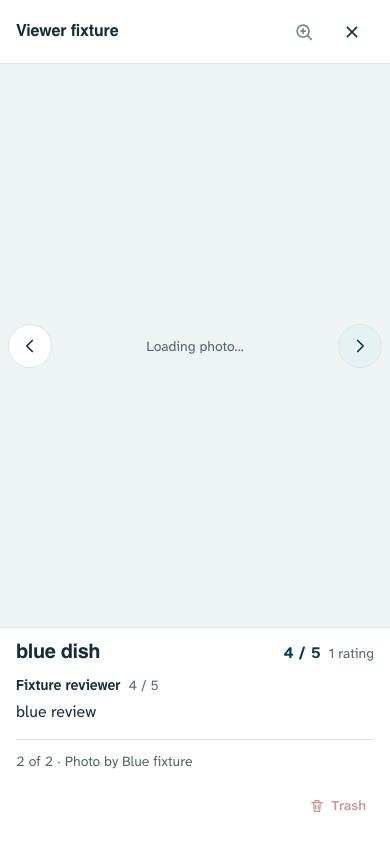
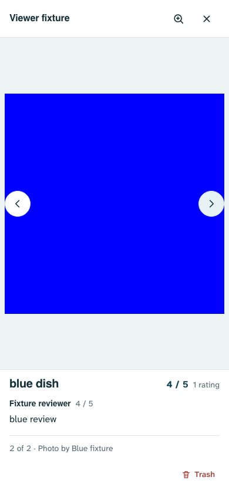
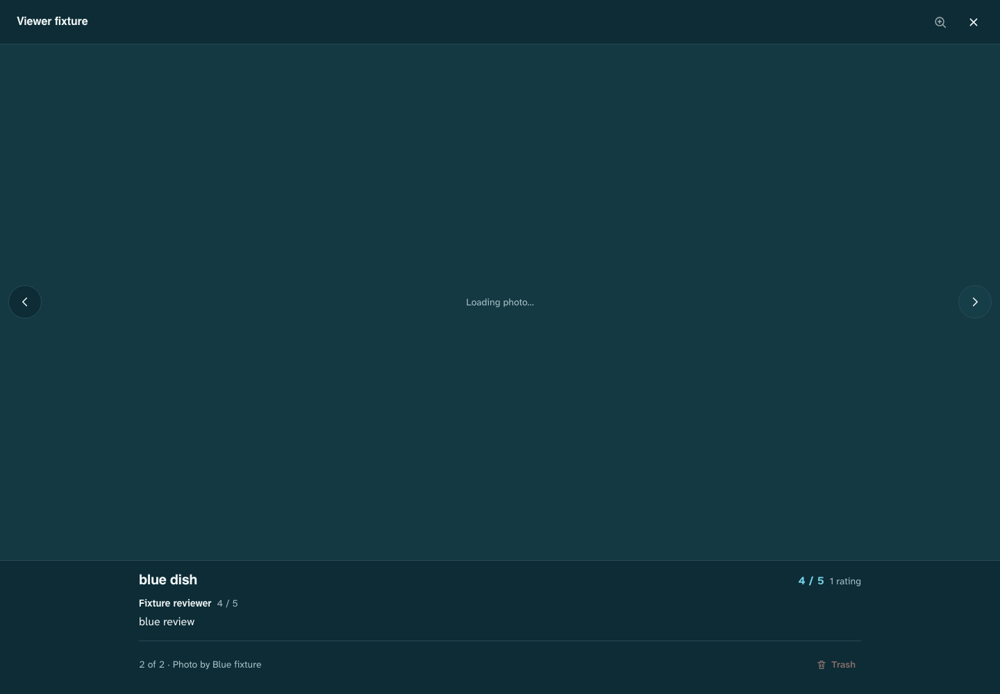

# Rendering and navigation fixes — 2 November 2026

Status: implemented locally on `design3.0`; not pushed or deployed. This completes the six reproduced findings in [the baseline audit](AUDIT.md). The baseline scripts/results describe the old behavior, not acceptance checks for this implementation.

## Result

| Audited weakness | Implemented behavior | Preserved constraints |
|---|---|---|
| Old bitmap with next-photo metadata/actions | Hide the old bitmap immediately, retain the image stage and show Loading photo until the selected original loads/decodes. Keep image-dependent actions disabled while pending or failed. Photo generations reject old load/decode/error completions. Next/Previous and Close remain available. | Full originals, review/credit separation, ownership, confirm/Trash recovery, photo-to-dish conversion and upload paths. |
| Reviews jumped after refresh/resize | Retain the selected tab’s required scroll extent across detail rendering and height changes; record the current scroll position without painting on scroll. Photos/reviews participate in visible-content anchoring. | Stationary tab switches, hero photo-count destination scrolling, safe areas, width-only debounced global layout rendering and existing Back/Forward policy. |
| Likes held up ready restaurants | Primary parsing preserves known reactions and paints without waiting for the optional query. Fresh Likes merge afterward only for the same request generation/account, unchanged local reaction state, and dishes not awaiting their own Like confirmation. New collection requests/account changes abort old optional reads; failure retains known Likes. | Real-access gate, server permissions, existing query scope, held browse order, own-account reactions and pending saves. |
| Photo tile focus reset | Connected embedded sections stay attached; existing focused nodes stay focused. If changed markup replaces a control, fallback identity includes the library/review key, with an active-panel fallback if the control disappears. | Keyed cards/images, safe text rendering, permission-aware review actions and preventScroll focus restoration. |
| Saved dish cover left a stale card | Include coverPhotoId in the detail fingerprint. An explicit Set as main resets that dish’s underlying carousel to the first image before repaint so the newly ordered cover is actually visible. | Ordinary background/carousel return state, existing cover save API, originals and legacy-photo behavior. The reset is scoped to the deliberate main-photo action. |
| Paging animation leaked into another viewer session | Own/cancel paging WAAPI motion on replacement, remount, close and direct manipulation. Ignore a queued old Close event when the viewer has already reopened. | Existing 220ms strong ease-out pointer paging, 280ms dismiss spring, 180ms restaurant drawer and reduced-motion gestures. Keyboard paging is immediate. |

No new library, migration, storage policy, account permission or production-data change is included. The earlier zoom-easing feel-check was not promoted into an unproven additional change.

## Upload safeguards reviewed and retained

Dany specifically recalled earlier image upload failures. The historical reasons were reviewed before implementation in [project history](../../docs/history/thought_Process-through-2026-10-13.md), especially 28 September and 3 October:

- Preserve independent photo bytes before resetting a picker; register the full batch and serialize queue writes/removal.
- Keep account/destination-scoped IndexedDB recovery, stable IDs/paths, exact-destination restoration and truthful retry status.
- Treat a reserved Storage path as a reservation, not proof of an upload. Confirm upload before inserting its row; recover a lost insert response without duplicating/reuploading.
- Preserve the upload deadline and retain its per-photo lock until the underlying Storage request settles. Storage uploads are not aborted by the new optional **read** cancellation.
- Keep failed device-write fallback, staged retry and compensation rules; do not erase pending originals or unknown Storage files.

`lib/photo-queue.js`, `lib/photo-delivery.js`, `lib/reliable-sync.js`, `commitQueuedPhoto()` and the application’s photo capture/persistence/upload/retry handlers remain unchanged. Only the gallery viewer portion of `lib/photo-gallery.js` changes. Primary collection loading still calls the existing background upload resumption path.

The SDK remains pinned at 2.110.8. The scoped Likes query uses the existing abortableQuery wrapper and the documented [Supabase read-request AbortSignal API](https://supabase.com/docs/reference/javascript/using-modifiers-abortsignal); this is not a change to Storage upload cancellation. Relevant [changelog](https://supabase.com/changelog) entries were checked; no dependency upgrade or API/schema rollout was needed.

## Validation

- Final syntax/unit check: **161 passed**, including original upload recovery/idempotency tests and three new viewer loading/decode/motion guards.
- Final full desktop/mobile Chromium suite: **464 passed, 28 intentional skips** (3.1 minutes), including the additional assertion that the new cover is visibly selected. A final unit-only strengthening followed; application source did not change after this browser run.
- Eight new browser scenarios (both project configurations) cover short-tab refresh/resize/upward-scroll retention, exact tile/node focus, primary-before-Likes painting, stale/failing query results, account changes, main-photo/card refresh, slow/superseded/failed images, guarded management and rapid close/reopen.
- Existing browser coverage includes failed device persistence and retry, corrupt-image recovery, partial-batch continuation, interrupted dish-photo selection, expired picker handles, multi-photo immediate Save, restore/Trash, gallery conversion/main-photo rules, real touch dismiss/interrupt/pinch, auth/startup and matching-service-worker behavior.
- A bounded final visual check used synthetic local images in phone light and desktop dark: pending image area contains no prior bitmap, the loading label is readable, navigation/Close remain and management is visibly disabled. Once decoded, the correct blue image appears and management enables. No additional decorative animation was introduced.
- Fixtures and mocked/blocked responses only; no production test records. Historical screenshot files regenerated by tests are restored rather than included as unrelated changes.

The first focused run exposed a queued native Close event clearing a reopened gallery; it was fixed and the focused regressions passed before full validation. Unit viewer tests now explicitly model loaded images because jsdom does not download them; separate pending/decode tests model delayed completion.

## Motion review

| Before | After | Why |
|---|---|---|
| Unowned paging keyframes affected newly assigned images | Retained animation handle with replacement/close/gesture cancellation | A photo/viewer session owns its motion. |
| Paging started before the original was ready | Pointer paging starts after load/decode, keyboard paging switches immediately | Avoid moving a stale bitmap and unnecessary keyboard motion. |
| Late native Close could clear a reopened viewer | Only a genuinely closed current dialog processes Close cleanup | Keep later navigation intent authoritative. |

Code-level verdict: the changed motion preserves the authored duration/curve, uses transform/opacity and honors reduced motion. Physical-device feel is not certified by Chromium automation.

## Limits and release status

Physical Safari/iPhone, mid-range Android GPU behavior, 120Hz delivery, actual weak-network uploads and real-cloud writes remain unverified. These checks establish the local regression behavior, not universal frame-rate or upload success. No push/deployment is implied.

